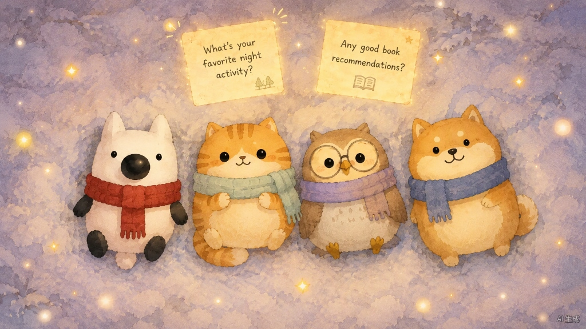
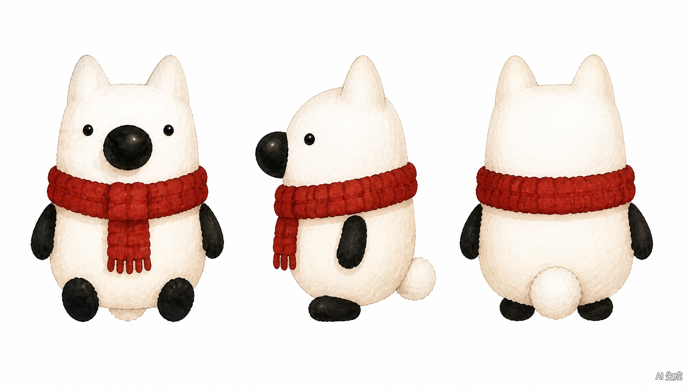
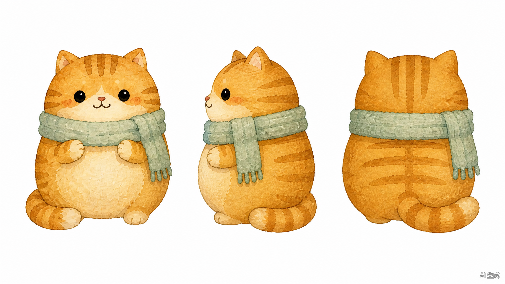
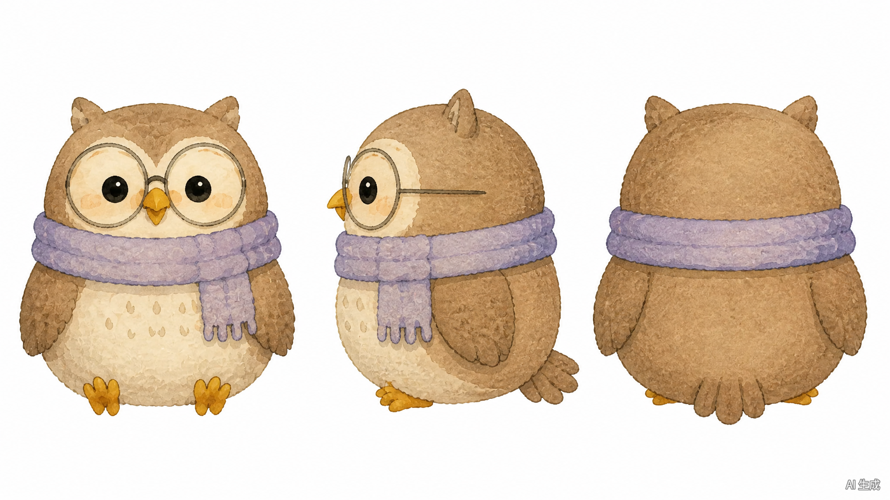
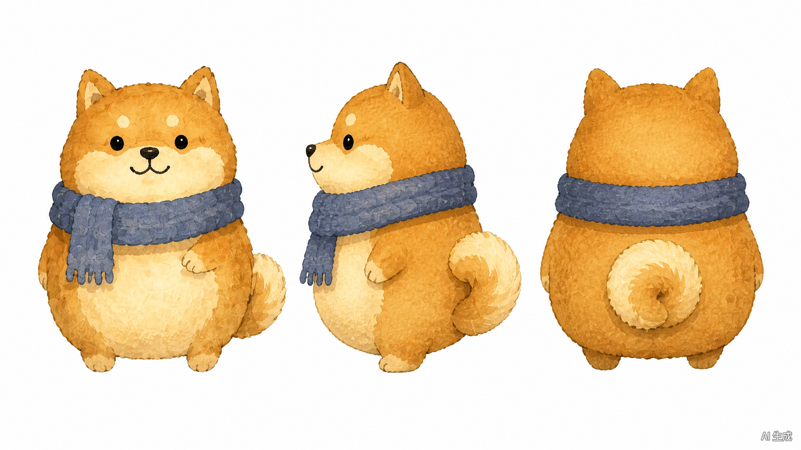
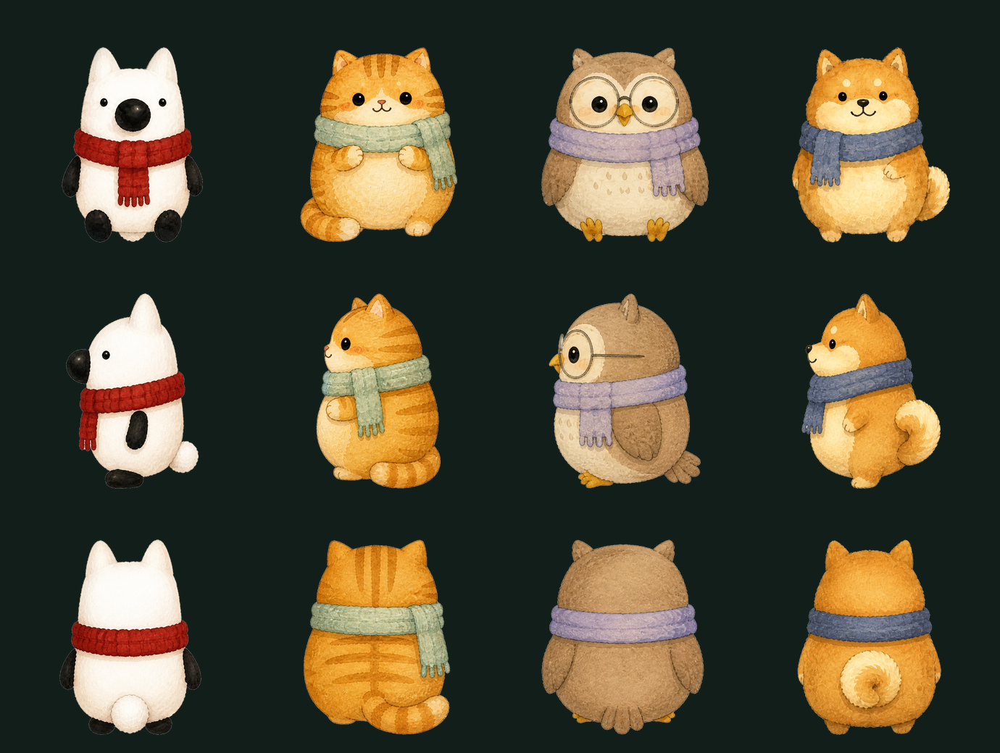
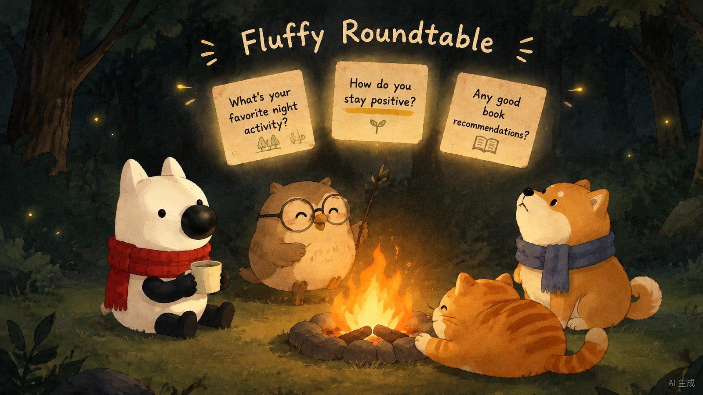
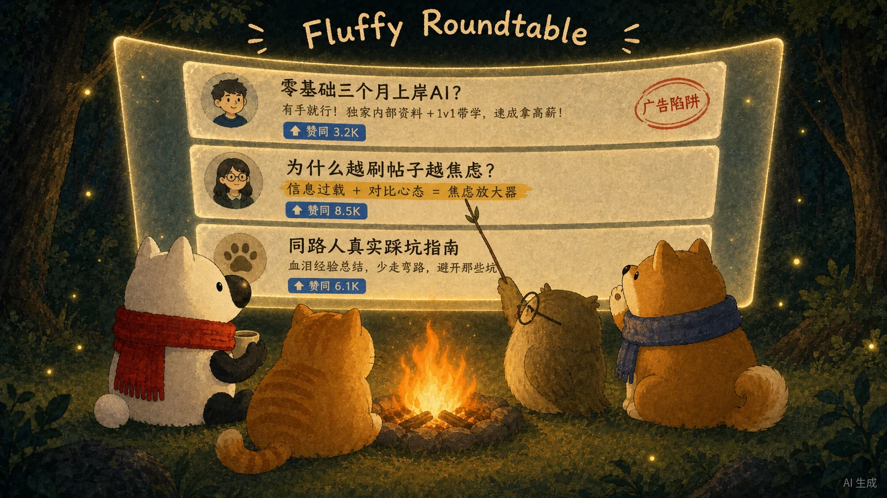
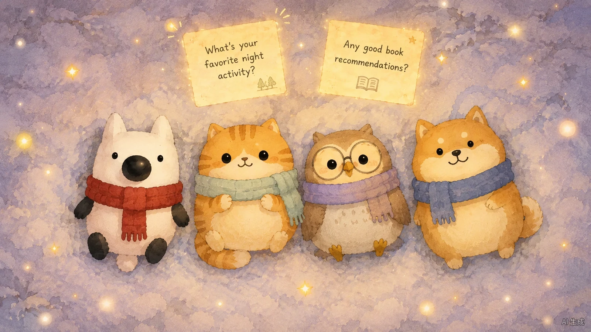

# 🐾 毛茸茸圆桌 · Fluffy Roundtable

> **「在这儿刷知乎。刷完乱了，就问它们。」**
> *——它知道你刚才看了什么，也一直都在。*

知乎黑客松 S3 · 湾区共创季参赛作品（赛道 02：AI × 陪伴与交互）。

---

## 💡 一句话说清我们在做什么

刷知乎最破防的瞬间，不是搜不到回答，而是**看了 10 个高赞：3 个在暗戳戳卖课引流、4 个在贩卖焦虑、3 个神仙打架谁也说服不了谁**。最后你关掉网页，把所有迷茫都怪在了自己头上。

**毛茸茸圆桌**不是一个只会回「抱抱你、别焦虑啦」的塑料陪聊桌宠。我们相信：**真正的温柔不是说好话，而是拿得出证据，证明那些帖子没帮上忙，真的不是你的错。**

当你在站内刷完一堆各执一词的回答、脑子乱成一团开口提问时，篝火与暖灯下的四只毛茸茸小动物会看着你刚刚刷过的浏览轨迹，为你开一场**围炉夜话**。

---

## 🪵 四只圆桌成员

| 角色 | 定位 | 它负责的那一拍 |
| :--- | :--- | :--- |
| 🐱 **呼噜猫** | 治疗行动官 | **先接住你**——不讲大道理、不给爹味建议，先递上一杯热可可 |
| 🦉 **考据猫头鹰** | 数据考据官 | **卸下自责**——推推眼镜，高亮原帖句子，用证据告诉你「那几篇没用不是你笨」 |
| 🐕 **护短柴犬** | 踩坑情报员 | **护短指路**——气鼓鼓替你骂走水帖，按你的真实背景重搜知乎，端出带原文引用与可点击溯源的 3 篇同路人实操帖 |
| 🦊 **刘看山** | 圆桌主持 | **守着这盏灯等你回来**——「不用急，看完随时回来找我们，我们一直都在这里。」 |

---

## 🔁 五拍情绪闭环

```
1️⃣ 被看到      🐱 呼噜猫    只接住情绪，绝不爹味说教
2️⃣ 卸下自责    🦉 考据猫头鹰  高亮原帖句子，用证据证明「不是你笨」
3️⃣ 护短指路    🐕 敏锐柴犬  按你的真实背景重搜，端出 3 篇可溯源的真话
4️⃣ 被留住      🦊 刘看山 & 清醒猫咖  拍板【我决定了】→ 小猫带着你的决定住进手账
5️⃣ 被陪伴      🐾 知乎 OAuth 一键入座 → 生成《我的知乎深夜冲浪精神状态 & 伴读守护兽》
```

**工具是用完就关的，但地方是可以随时回来的。**

---

## 🖼️ Image2 角色三视图、透明立绘与概念视觉

### 雪地围巾定妆参考 & 四角色 Image2 三视图（2048 × 1152）










### 12 张正/侧/背透明 PNG 精灵实测（已去背可直接用于前端多视角动效）


> 原始三视图档案位于 [`assets/turnarounds/`](assets/turnarounds/)，经 Edge Flood-Fill 精抠并去水印后的 12 张透明 PNG（`{kanshan,cat,owl,shiba}-{front,side,back}.png`，高 `680px`）位于 [`assets/sprites/`](assets/sprites/)。

### 初版概念稿与大光幕设定







---

## 🎮 前端动效交互原型（浏览器打开即体验）

| 原型文件 | 内容 |
| :--- | :--- |
| [`prototypes/fluffy-roundtable-5step-demo.html`](prototypes/fluffy-roundtable-5step-demo.html) | 5 步连贯交互动画原型（侧边栏待机 → 唤醒 → 跃出开门 → 动物登场 → 高对比度陪聊） |
| [`prototypes/fluffy-roundtable-galgame-v1.html`](prototypes/fluffy-roundtable-galgame-v1.html) | 视觉剧场初版（含刘看山浏览时长/篇数劝休播报、3 套温馨背景切换、角色差分反应与分支选项） |

---

## 📚 文档索引

| 文档 | 内容 |
| :--- | :--- |
| [`docs/01-知乎圈子宣传通稿与配图提示词全集.md`](docs/01-知乎圈子宣传通稿与配图提示词全集.md) | 知乎圈子宣传通稿与早期 2D 手绘水彩概念图提示词 |
| [`docs/02-项目策划与技术架构全案.md`](docs/02-项目策划与技术架构全案.md) | 早期赛事策划、知乎开放平台 API 盘点与技术栈调研 |
| [`docs/03-毛茸茸圆桌-产品设计与技术实现全案-for-Claude.md`](docs/03-毛茸茸圆桌-产品设计与技术实现全案-for-Claude.md) | 一体化 Web 架构全案（AiWorks 无外置库兼容、纯真实知乎 API 数据约束与前后端施工蓝图） |
| [`docs/04-UI交互预览与前端动效实现指南.md`](docs/04-UI交互预览与前端动效实现指南.md) | 界面视觉问题诊断、Image2 三视图与 12 张正/侧/背透明精灵素材表、Framer Motion 五段式动效时序 |
| [`docs/05-五步动画分镜与三视图生图提示词.md`](docs/05-五步动画分镜与三视图生图提示词.md) | 侧边栏到聊天框 5 步分镜提示词 + 四动物三视图（正视/侧视/背视）全套生图提示词 |
| [`docs/06-Galgame差分立绘与温馨背景及劝休指南.md`](docs/06-Galgame差分立绘与温馨背景及劝休指南.md) | 合规降敏版温馨背景提示词（3 方案）、同姿三态差分立绘写法与刘看山劝休播报规范 |

---

## 🛠️ 技术栈与数据来源

- **前端**：响应式 Web（PC / 移动端自适应），2D 手绘绘本风的温暖数字手账 UI
- **后端**：Node.js 服务端托管 `app_key` / Access Secret，封装知乎开放平台请求与 OAuth 会话
- **数据源**：知乎开放平台真实正式服
  - `hot_list` 热榜（100 次/天，服务端 15 分钟缓存）
  - `zhihu_search` 站内搜索（5,000 次/天，含 `AuthorityLevel` 权威度与精选评论）
  - `global_search` 全网搜索（5,000 次/天，用于打破社区回音室）
  - `question_answers` 回答摘要流、`zhida_openai` 直答（100 次/天）
  - `user_data` OAuth 用户关注 / 收藏 / 创作（10,000 次/天）
- **设计原则**：高频检索走 5,000 次额度的搜索接口 + 自有 LLM 合成圆桌，绕开直答 100 次/天瓶颈；同一问题 URL 的拆解结果做 Hash 缓存，多人同看一条热榜只消耗 1 次额度

---

## 📦 仓库结构

```
fluffy-roundtable/
├── README.md
├── docs/
│   ├── 01-知乎圈子宣传通稿与配图提示词全集.md
│   ├── 02-项目策划与技术架构全案.md
│   ├── 03-毛茸茸圆桌-产品设计与技术实现全案-for-Claude.md
│   ├── 04-UI交互预览与前端动效实现指南.md
│   ├── 05-五步动画分镜与三视图生图提示词.md
│   └── 06-Galgame差分立绘与温馨背景及劝休指南.md
├── prototypes/
│   ├── fluffy-roundtable-5step-demo.html
│   └── fluffy-roundtable-galgame-v1.html
└── assets/
    ├── turnarounds/      # Image2 四角色原版三视图 (2048×1152) & 雪地围巾定妆参考
    │   ├── snow-scarf-4animals-ref.jpg
    │   ├── liukanshan-turnaround-sheet.png
    │   ├── ginger-cat-turnaround-sheet.png
    │   ├── owl-turnaround-sheet.png
    │   └── shiba-turnaround-sheet.png
    ├── sprites/          # 12 张去背多视角透明 PNG（front / side / back）& 深底实测图
    │   ├── verify-image2-on-dark.png
    │   ├── kanshan-{front,side,back}.png
    │   ├── cat-{front,side,back}.png
    │   ├── owl-{front,side,back}.png
    │   └── shiba-{front,side,back}.png
    ├── images/           # 概念图与产品视觉（1600×900 WebP）
    │   ├── 01-campfire-roundtable.webp
    │   ├── 02-snow-stardust.webp
    │   ├── 03-screen-meeting.webp
    │   └── 04-hq-backview.webp
    └── ip/               # 知乎官方刘看山 IP 素材
        ├── kanshan-three-views.jpg
        ├── kanshan-3q-white-bg.jpg
        └── kanshan-3q-green-screen.jpg
```

---

## 🏆 赛事信息

- **赛事**：知乎黑客松 S3 · 湾区共创季
- **赛道**：02 AI × 陪伴与交互（社区 × 数字伙伴）
- **提交窗口**：12.05 10:00 – 12.07 10:00
- **决赛路演**：12.19 深圳（5 分钟 Demo + 3 分钟 Q&A）

---

<div align="center">

**正在全力肝代码与小动物立绘中 🐾**

*欢迎在评论区留下「你最近在知乎刷完最纠结/最破防的一个问题」——我们会把它做成圆桌的首批预置深夜剧本。*

</div>
