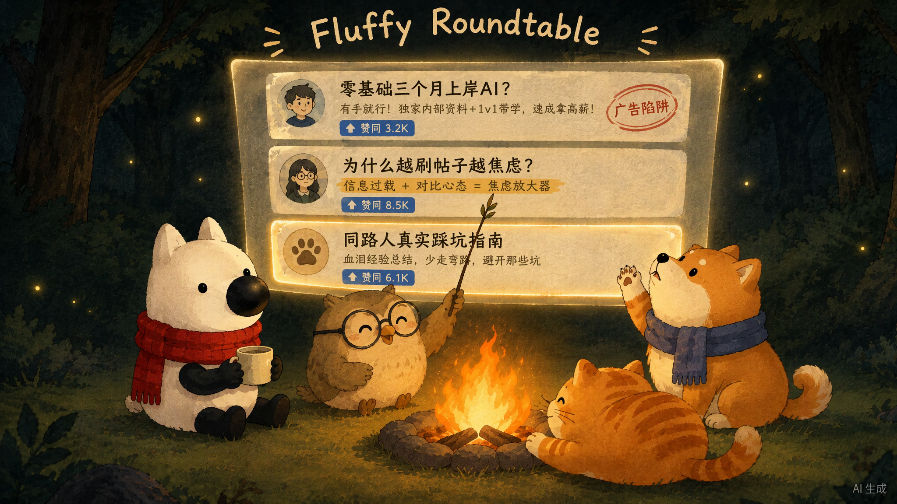

# 🐾 毛茸茸圆桌 · Fluffy Roundtable

> **「在这儿刷知乎。刷完乱了，就问它们。」**
> *——它知道你刚才看了什么，也一直都在。*

知乎黑客松 S3 · 湾区共创季参赛作品（赛道 02：AI × 陪伴与交互）。

---

## 💡 一句话说清我们在做什么

刷知乎最破防的瞬间，不是搜不到回答，而是**看了 10 个高赞：3 个在暗戳戳卖课引流、4 个在贩卖焦虑、3 个神仙打架谁也说服不了谁**。最后你关掉网页，把所有迷茫都怪在了自己头上。

**毛茸茸圆桌**不是一个只会回「抱抱你、别焦虑啦」的塑料陪聊桌宠。我们相信：**真正的温柔不是说好话，而是拿得出证据，证明那些帖子没帮上忙，真的不是你的错。**

当你在站内刷完一堆各执一词的回答、脑子乱成一团开口提问时，篝火与暖灯下的四只毛茸茸小动物会看着你刚刚刷过的浏览轨迹，为你开一场**围炉夜话**。

---

## 🪵 四只圆桌成员

| 角色 | 定位 | 它负责的那一拍 |
| :--- | :--- | :--- |
| 🐱 **呼噜猫** | 治疗行动官 | **先接住你**——不讲大道理、不给爹味建议，先递上一杯热可可 |
| 🦉 **考据猫头鹰** | 数据考据官 | **卸下自责**——推推眼镜，高亮原帖句子，用证据告诉你「那几篇没用不是你笨」 |
| 🐕 **护短柴犬** | 踩坑情报员 | **护短指路**——气鼓鼓替你骂走水帖，按你的真实背景重搜知乎，端出带原文引用与可点击溯源的 3 篇同路人实操帖 |
| 🦊 **刘看山** | 圆桌主持 | **守着这盏灯等你回来**——「不用急，看完随时回来找我们，我们一直都在这里。」 |

---

## 🔁 五拍情绪闭环

```
1️⃣ 被看到      🐱 呼噜猫    只接住情绪，绝不爹味说教
2️⃣ 卸下自责    🦉 考据猫头鹰  高亮原帖句子，用证据证明「不是你笨」
3️⃣ 护短指路    🐕 敏锐柴犬  按你的真实背景重搜，端出 3 篇可溯源的真话
4️⃣ 被留住      🦊 刘看山 & 清醒猫咖  拍板【我决定了】→ 小猫带着你的决定住进手账
5️⃣ 被陪伴      🐾 知乎 OAuth 一键入座 → 生成《我的知乎深夜冲浪精神状态 & 伴读守护兽》
```

**工具是用完就关的，但地方是可以随时回来的。**

---

## 🖼️ 视觉概念图

### 主视觉：篝火圆桌 · 四小只开会


### 头脑特工队式大光幕 × 长条形知乎帖子围炉开会


### 经典总部半背影视角变体


### 情绪共鸣副图：雪地星尘并排仰望


---

## 📚 文档索引

| 文档 | 内容 |
| :--- | :--- |
| [`docs/01-知乎圈子宣传通稿与配图提示词全集.md`](docs/01-知乎圈子宣传通稿与配图提示词全集.md) | 知乎圈子宣传通稿（深夜故事破防版 / 短平快金句版）+ Image 2 全量配图提示词（中英双语，2D 手绘水彩团子风） |
| [`docs/02-项目策划与技术架构全案.md`](docs/02-项目策划与技术架构全案.md) | 赛事规则与评分权重对齐、双重痛点破题、四大功能模块、知乎开放平台全量 API 盘点（含配额与 OAuth 协议避坑）、技术栈选型与缓存策略、Claude 审阅问题清单 |

---

## 🛠️ 技术栈与数据来源

- **前端**：响应式 Web（PC / 移动端自适应），2D 手绘绘本风的温暖数字手账 UI
- **后端**：Node.js 服务端托管 `app_key` / Access Secret，封装知乎开放平台请求与 OAuth 会话
- **数据源**：知乎开放平台真实正式服
  - `hot_list` 热榜（100 次/天，服务端 15 分钟缓存）
  - `zhihu_search` 站内搜索（5,000 次/天，含 `AuthorityLevel` 权威度与精选评论）
  - `global_search` 全网搜索（5,000 次/天，用于打破社区回音室）
  - `question_answers` 回答摘要流、`zhida_openai` 直答（100 次/天）
  - `user_data` OAuth 用户关注 / 收藏 / 创作（10,000 次/天）
- **设计原则**：高频检索走 5,000 次额度的搜索接口 + 自有 LLM 合成圆桌，绕开直答 100 次/天瓶颈；同一问题 URL 的拆解结果做 Hash 缓存，多人同看一条热榜只消耗 1 次额度

---

## 📦 仓库结构

```
fluffy-roundtable/
├── README.md
├── docs/
│   ├── 01-知乎圈子宣传通稿与配图提示词全集.md
│   └── 02-项目策划与技术架构全案.md
└── assets/
    ├── images/           # 概念图与产品视觉
    │   ├── 01-campfire-roundtable.png
    │   ├── 02-snow-stardust.png
    │   ├── 03-screen-meeting.png
    │   └── 04-hq-backview.png
    └── ip/               # 知乎官方刘看山 IP 素材
        ├── kanshan-three-views.jpg
        ├── kanshan-3q-white-bg.jpg
        └── kanshan-3q-green-screen.jpg
```

---

## 🏆 赛事信息

- **赛事**：知乎黑客松 S3 · 湾区共创季
- **赛道**：02 AI × 陪伴与交互（社区 × 数字伙伴）
- **提交窗口**：12.05 10:00 – 12.07 10:00
- **决赛路演**：12.19 深圳（5 分钟 Demo + 3 分钟 Q&A）

---

<div align="center">

**正在全力肝代码与小动物立绘中 🐾**

*欢迎在评论区留下「你最近在知乎刷完最纠结/最破防的一个问题」——我们会把它做成圆桌的首批预置深夜剧本。*

</div>
