# 🐾 毛茸茸圆桌 · Fluffy Roundtable

> **在这儿刷知乎。刷完乱了，就问它们。**
> *看山陪你读这一页；哪些话留到下次，由你做主。*

知乎黑客松 S3 · 赛道 02（AI × 陪伴与交互）参赛作品。
知乎热榜与回答来自真实开放平台。未连上时，可以明确选择编辑室的本地试读；试读内容不是知乎数据。

---

## 产品总设计稿 v1.0｜先听懂，再接话

[阅读总设计稿](docs/superpowers/specs/2026-11-24-intent-first-cabin-design.md) · [固定版本 `design-v1.0`](https://github.com/Wattson-Law/fluffy-roundtable/tree/design-v1.0)

**设计验收看一句话：读者改口，下一句就要变。** 文中标注了六个对话场景、四位伙伴的分工、记忆边界和首轮试用标准。这是产品目标，不是功能上线清单；当前能体验的部分见下文。

### 11 月 25 日可试版｜在同一座小屋里读、聊、旁听

点开看山，可以聊刚读的一句，也可以说「你们挑一条新闻聊聊，我听着」。想让伙伴继续才连续播；动笔或收屋就停。读者自己说过的近况放在「伙伴记得」，自己想留下的一句话放在「我的念头」。两者都不是文章收藏，更不是给读者贴标签。

<p><a href="docs/proposal-acceptance/listening-rumor.png">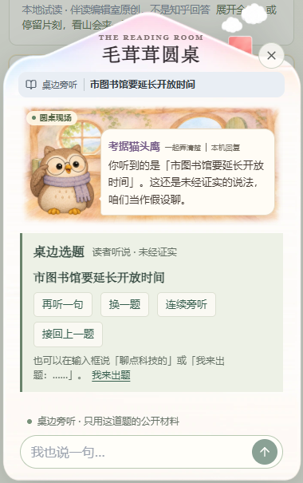</a> <a href="docs/proposal-acceptance/reader-thought.png">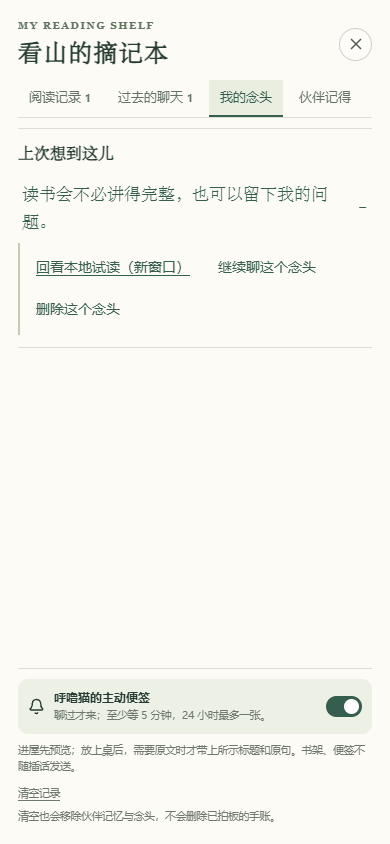</a></p>

[本版验收和复验步骤](docs/proposal-acceptance.md) · [阅读、四位人设与模型实测](docs/pet-model-test.md) · [原图和开屋动效](assets/README.md)。上图为正式界面和虚构测试输入，不是知乎新闻事实或真人记录。

### 现在可试：两桌不留记录的「窗边试聊」

[下载发给读者的离线包（ZIP）](docs/reader-trial/window-seat.zip?raw=true) · [主持人说明与反馈卡汇总](docs/reader-trial/README.md)

解压后用浏览器打开 `window-seat.html`，或者在运行中的新版应用打开 `/trial`。同一套伙伴、立绘和接话逻辑，**不看个人书架，不收聊天原话**。每位读者用自己的话坐两桌：一次中途改口，一次带着现实难处求支持。最后可以只带走六个勾选，也可以什么都不留。五人试用尚待进行；邀请读者时只发试用包，不发下面的开发示例。

### 第一次落地：读者一改口，伙伴就换一种接法

[技术路线与后续取舍](docs/superpowers/plans/2026-11-24-intent-first-iteration.md) · [本轮验收与五人试用提纲](docs/intent-first/README.md)

不读文章也能聊。点窗沿的看山，试着说「我想去，就是有点怕」，再说「不用分析，给我点鼓励」。前一句猫会问你卡在哪里，后一句柴犬会只给支持，不把练习讲完。你也可以点名让猫头鹰给你打气。下面是同一段对话在正式界面的实机截图，不是概念图。

<p><a href="docs/intent-first/desktop.png">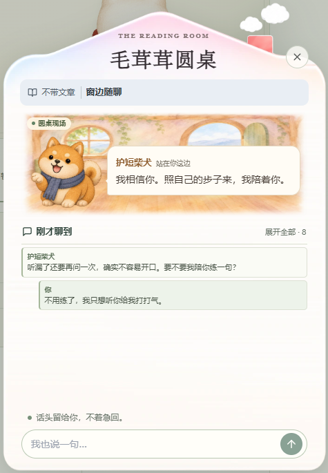</a> <a href="docs/intent-first/mobile.png">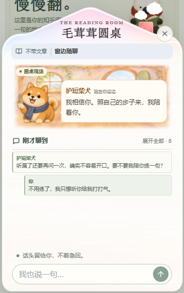</a></p>

## 正式应用：看山伴读与猫猫便签

本机桌宠预览推荐 `npm run dev:pets`（只在本机监听）；常规开发可用 `npm run dev`。打开 `http://localhost:3100`。想不依赖外部服务走一遍，可直接打开 `http://localhost:3100/?sample=weekend-notebook`。这个入口使用**同一个正式界面**，文章和引文都标为「本地试读」，不会混入知乎分析。

- **随读随记**：展开全文、点开回答原帖，或在前台同一篇回答停留 2.5 秒即夹书签。快速滑过、后台页面、被小屋或手账盖住的回答都不计；重读更新次数和顺序。顶部「阅读记录」可重读原文、按篇开聊。书架保留最近 100 篇；桌面材料只取**本标签页本次实际读过**的至多 5 篇同来源内容。收屋、刷新、切后台不丢桌；关闭页面后再开，不会把昨天的文章带来。「和它们聊这篇」只带你选中的那篇；「过去的聊天 → 继续这段聊天」才回原来那一桌。
- **按自己的速度开桌**：点窗沿伏案的刘看山，看伙伴进屋。想听文章导读再按「开聊」「听下一句」；也可以一开始就说自己的事。插话即结束旧导读，不再自动回到四人轮次。猫先听，猫头鹰理清说法，柴犬既能给支持也能陪练，看山在有必要时收尾。仍想要文章卡，可从「本轮阅读与原帖」主动取出；点「我拍板」才进猫咖手账。首页的「认识四位伙伴」可以手动翻看四只动物的十二张动作立绘与各自的职责。
- **猫猫有分寸地问候**：读者本人说过的重要近况可以跨月问一次，不把“当时”说成“现在”。亲自输入、前台空闲至少 5 分钟、没有聊天或念头草稿才可能收到；24 小时最多一张。屋外只有「有空聊两句吗？」，点开才看到内容。普通未完的聊天只在同一桌、七天内接一次。没回就不追问。
- **记忆与念头**：「阅读记录 → 伙伴记得」能更正、禁止主动提起或忘记同一条小记，四只一起生效。单说「那是我朋友的事」可以纠正归属。「记个念头」只存本人确认的一行，可选择关联当下原文；下次打开不会自动发送。「继续聊」只把它放进可改的输入框。
- **不想谈心就旁听**：有榜从知乎第一条开始，「没兴趣」换题，「聊点科技的」只搜索所说范围。没取到榜或评论就明说；传闻按假设聊，柴犬的设想不是网友意见。连续旁听需主动同意，换桌、输入、切后台不继续播；公共话题不进个人画像。
- **不必回应**：可以点「先不聊」、在聊天中说「先不聊了」，或在「阅读记录」关闭主动便签。阅读、聊天和已拍板手账分开保存；清空阅读与聊天不会清掉手账。数据不跨设备同步；禁止存储时本页仍可用。便签及默认模式的自由插话在本机处理；只点开桌宠不提交文章；从书架按篇开桌也只在本机预览。主动选「文章导读」或在真实正文点「拿这句去圆桌」时，才走单独的文章分析；选择决策芯片时只发送所选项与主题。

**桌宠真模型联调（仅本机开发）**：还是热榜首页右下角的看山。先预览并点「把这段放上桌」，读者再问文章，伙伴才能用选段回答；只读、开屋和放上桌都不会发送文章。问事实只引核对过的原句，缺依据就明说。读同一篇时改口「我只想吐槽」，猫会放下材料听你说；想去但不敢，不会被当成在问该不该去。事实已答完，或伙伴正等你的回答，就不用再请第二只；邀请另一位也允许它不说。撤下、换题、收屋或刷新后，之前的共享不会自动恢复，原聊天仍可在本机回看。见[三种说法的真实对照](docs/handoff-intent.md)、[四份人设与联调方式](docs/pet-model-test.md)。离线试用版仍是离线版。

检查：`npm run test:companion`（Node 22.18+ 或 24），`npm run build`，之后运行 `npm run test:companion:api` 可用本机测试替身验证生产接口（不消耗在线额度）。可选桌面/移动浏览器回归：运行网页后执行 `python scripts/verify_companion.py --channel msedge`（需要 Python Playwright）。[阅读到群聊压力验收](docs/reading-pressure.md) 区分本机并发、桌面/手机流程和少量真实模型验收；`npm run stress:pets` 全程不消耗模型额度。真实知乎联调另跑 `npm run smoke`，需要服务端配置知乎访问凭据。

### 带一句原文去圆桌

读到在意的一句，电脑上直接划选，手机或键盘可以点「逐句挑选」，再点「拿这句去圆桌」。同篇不同句各有一桌；整篇开聊的入口照旧。无需外部服务的体验入口：`http://localhost:3100/?sample=weekend-notebook`。

<p>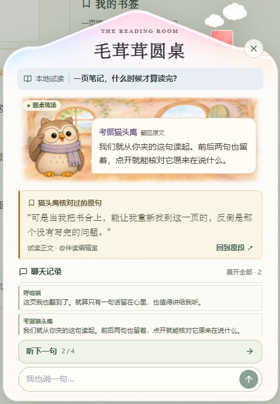 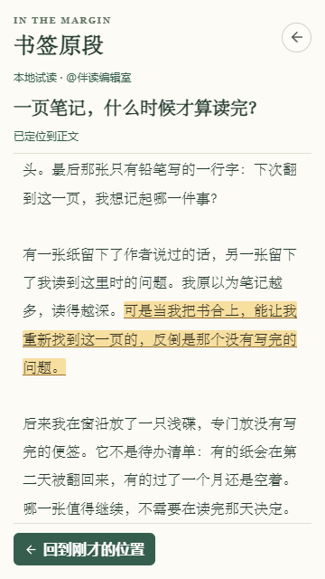</p>

- **书签能翻回去。** 从小屋、阅读记录或手账进入。原文仍在时高亮相应位置；不在、改过又无法唯一匹配时，明示「夹签时保存的摘录」，不把相似段落当原文。手账独立保存原帖地址、原句和有限前后文，清空聊天不会删掉已拍板的卡。
- **四位伙伴不抢同一件事。** 呼噜猫听你在意什么；猫头鹰核对所选原句；柴犬区分作者正文和读者评论，未取得精选评论就说明；看山把原句和行动卡一起收好。猫的便签依旧只在本机按同桌近期聊天选措辞，不把摘录或聊天原话放到窗边，已收卡或明确结束后不再追问。
- 一次最多夹 **160 字**。打开真实书签圆桌时只发这一篇的有限正文、来源信息和精选评论；不会附带其他文章或私人聊天。本地试读不会发送分析请求。

[五人试用提纲、电脑和手机验收方法](docs/sentence-bookmarks/README.md)

## 看一遍这版圆桌 · V6.1

点右下角正在写字的刘看山，窗沿就展开成小屋。猫头鹰飞上圆窗，呼噜猫和柴犬先后跑进来。等它们坐稳，第一句对话才出现。

<p align="center">
  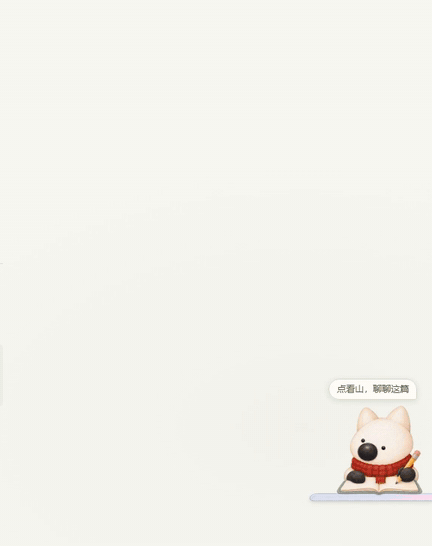
  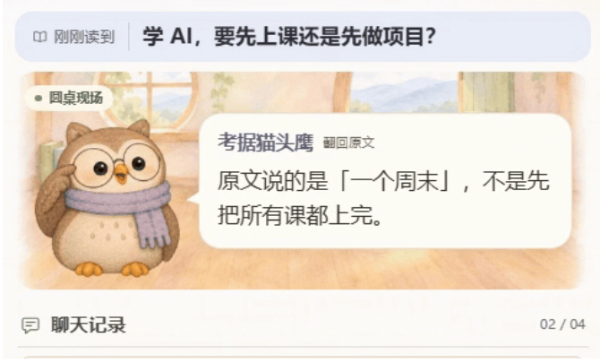
</p>

### 四位伙伴的原始三视图

依次是**刘看山、呼噜猫、考据猫头鹰、护短柴犬**。每张都是原始设定图，点图可放大看正面、侧面和背面的细节。

<p align="center">
  <a href="assets/turnarounds/liukanshan-turnaround-sheet.png">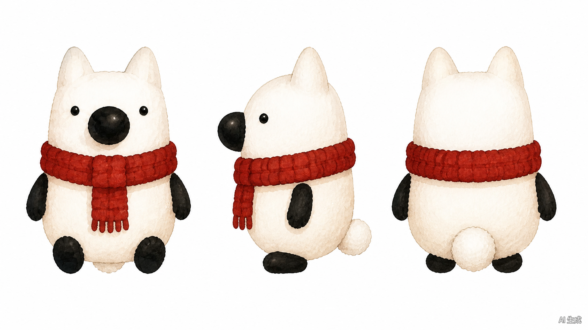</a>
  <a href="assets/turnarounds/ginger-cat-turnaround-sheet.png"></a>
</p>
<p align="center">
  <a href="assets/turnarounds/owl-turnaround-sheet.png">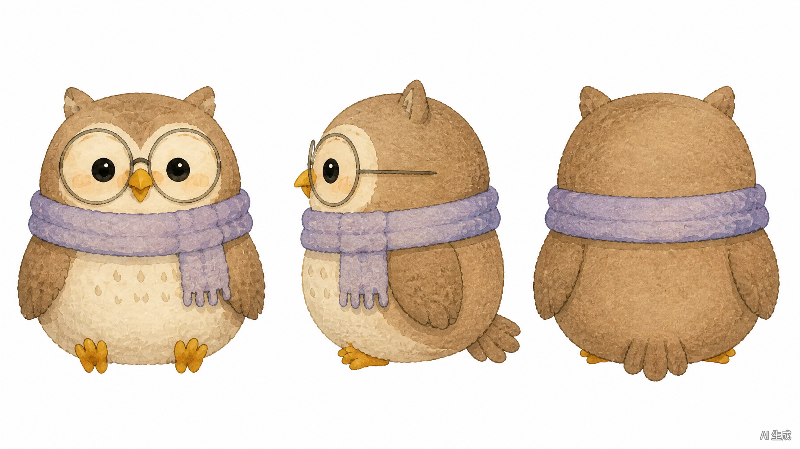</a>
  <a href="assets/turnarounds/shiba-turnaround-sheet.png">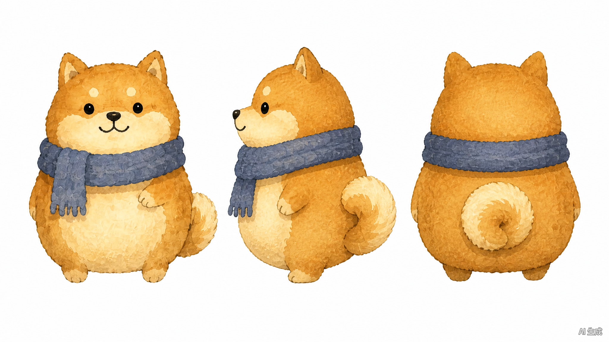</a>
</p>

### 四位伙伴的动作立绘

刘看山伏案写字、举起放大镜、捧书阅读；呼噜猫从打盹到踱步，再追起蝴蝶。猫头鹰展翅、低头沉思、放声笑，柴犬则咧嘴笑、追皮球，最后趴下休息。

[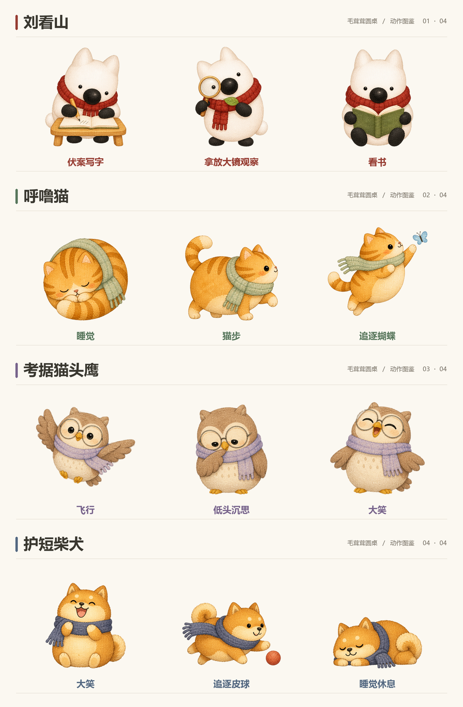](assets/action-poses/v1/overview.png)

[按角色查看和下载透明单图](assets/action-poses/v1/README.md) · [整套下载（ZIP）](assets/action-poses/v1/roundtable-action-poses-v1.zip?raw=true)

### 圆桌里怎么接话

呼噜猫说完，先从画面退下，猫头鹰再接过话。气泡留在原处，不催着你读下一句。


**[下载可点击原型](public/previews/roundtable-v6.1/index.html)**（GitHub 文件页点 **Download raw file**，双击下载的 HTML，无需安装或密钥） · [看 44.5 秒全程演示](docs/visual-target-v6.1/media/walkthrough.mp4) · [原始素材总索引](assets/README.md) · [定稿图、透明立绘与可编辑源文件](docs/visual-target-v6.1/README.md)

这是前端和动效的**设计目标**。原型使用两篇本地示例，不连知乎；下方正式应用的真实数据流程没有被替换。

## 四位伙伴怎样接话

| 伙伴 | 同一桌里的职责 |
|---|---|
| 呼噜猫 | 接住情绪，愿意听，不催人给答案。只有它负责主动问候。 |
| 考据猫头鹰 | 定义和观察问题，区分原文、评论、传闻与猜测；没有依据就说没有。 |
| 护短柴犬 | 忠诚、热心。读者要办法才给可做的一步；只要打气时就站在他这边。 |
| 刘看山 | 主持，需要时把已说清的事收成一句，交还话头。没人需要总结时也可以不说。 |

四位不必轮流说完。文章导读和掌控卡仍然保留：想核对原句再开导读，想把结论与原帖一起记进猫咖手账再点「我拍板」。

---

## 本地运行

```bash
cp .env.example .env.local   # 填入 ZHIHU_ACCESS_SECRET
npm install
npm run dev                  # http://localhost:3100
npm run smoke                # 全链路冒烟（56 项）
```

**LLM 为可选增强**：未配置 `LLM_*` 时自动降级为规则引擎，四小只照常开会，Demo 永不白屏。

### 历史绘本与原始大图（现役首页无需额外复制）

`public/assets/images/` 与 `public/assets/ip/` 下的 7 个运行时文件没有重复提交；对应的场景原图和看山参考图保存在[原始美术目录](assets/README.md)。现役首页、小屋与伙伴图鉴直接引用仓库内的定稿素材。若需复现历史版绘本布局，可从归档或本地素材补齐：

```bash
# 方式 A：本地素材
cp "F:\图片\知乎\毛茸茸圆桌会\*.png" public/assets/images/
unzip -j "F:\图片\知乎\kanshan-three-views.zip" "看山三视图/*.jpg" -d public/assets/ip/

# 方式 B：仓库内已有等价的归档素材
#   assets/images/*.png（原尺寸，保留原图，不被 WebP 替换）
#   assets/images/*.webp（1600×900 压缩版）
#   assets/ip/kanshan-*.jpg（同源刘看山三视图）
```

细节见 [`HANDOVER.md`](HANDOVER.md) §六。

## 架构要点

- **无数据库**（适配知乎 AiWorks）：服务端仅进程内 TTL 缓存；阅读、私聊和手账存在本机 `localStorage`。本标签页用 `sessionStorage` 只存本次阅读与座位的标识、次数和时间，不另存网址、私聊或原文。
- **额度防爆仓**：`hot_list` 15 分钟缓存、搜索 30 分钟缓存、圆桌结果 30 分钟缓存；额度 <15% 自动延长 TTL ×4
- **每轮圆桌最多消耗 2 次搜索额度**（`global_search` ×1 + `zhihu_search` ×1）
- **防幻觉三重保险**：素材编号 `READ_x`/`EXT_x`/`NEW_x` → 引文逐字校验是否为原文子串 → `curatedSources` 由服务端按索引回填真实 URL，LLM 永不生成链接

## 文章导读的历史台词约束（自由聊天另按总设计稿）

1. 永远说「它没在回答你此刻的问题」，**绝不说某篇知乎回答写得烂**
2. 呼噜猫第一句只接情绪，出现「不过/但是/你可以/建议你」即丢弃该条
3. 绝不承诺「剩下的都没问题」

## 目录

```
src/
├── app/
│   ├── page.tsx                      # 模拟知乎 + 侧边刘看山 + 小屋浮层
│   └── api/
│       ├── zhihu/{hot,search,quota}  # 知乎开放平台代理（含缓存与降级）
│       └── roundtable/{analyze,follow-up}
├── lib/
│   ├── zhihu-client.ts               # Bearer + Timestamp 封装、字段归一化
│   ├── cache.ts                      # 进程内 TTL 缓存
│   ├── llm.ts                        # 圆桌编排 Prompt + 防幻觉校验
│   ├── fallback-engine.ts            # 规则兜底引擎（LLM 不可用时独立撑场）
│   └── storage.ts                    # localStorage：轨迹 / 手账
└── components/{zhihu-sim,companion,cabin,journal}/
```

## 仓库归档（策划 · 素材 · 原型）

仓库同时保留项目早期的策划全案、Image2 素材与 HTML 动效原型，均不影响 Next.js 应用运行：

| 路径 | 内容 |
|---|---|
| [`docs/08-项目介绍与素材索引（原 README 归档）.md`](docs/08-项目介绍与素材索引（原 README 归档）.md) | 完整项目介绍、角色设定与素材索引（原仓库首页） |
| [`docs/`](docs/) | 01–07：宣传通稿、策划与技术架构全案、UI 动效指南、分镜与三视图提示词、Galgame 差分立绘、11.16 拉门小屋进度 |
| [`docs/visual-target-v6.1/`](docs/visual-target-v6.1/) | 当前交互目标：认可的角色立绘、动效、可重建的单页原型 |
| [`prototypes/`](prototypes/) | 早期 3 个浏览器直接打开的交互动效原型（5 步 Demo / Galgame v1 / 拉门小屋聊天室） |
| [`assets/`](assets/) | 12 张去背多视角图、四角色原始三视图、12 张透明动作立绘、界面预览、概念图与刘看山 IP 素材 |

> 只看图不必克隆仓库：可直接在本页预览，或单独下载上方的动作素材包。

## 进度

- **Phase 1（P0）** ✅ 真实 API 端到端闭环已跑通
- **Phase 2（P1）** 待办：OAuth 登录模块、决断卡图片导出
- **Phase 3（P2）** 待办：AiWorks 公网部署、移动端实测、正式应用演示视频
