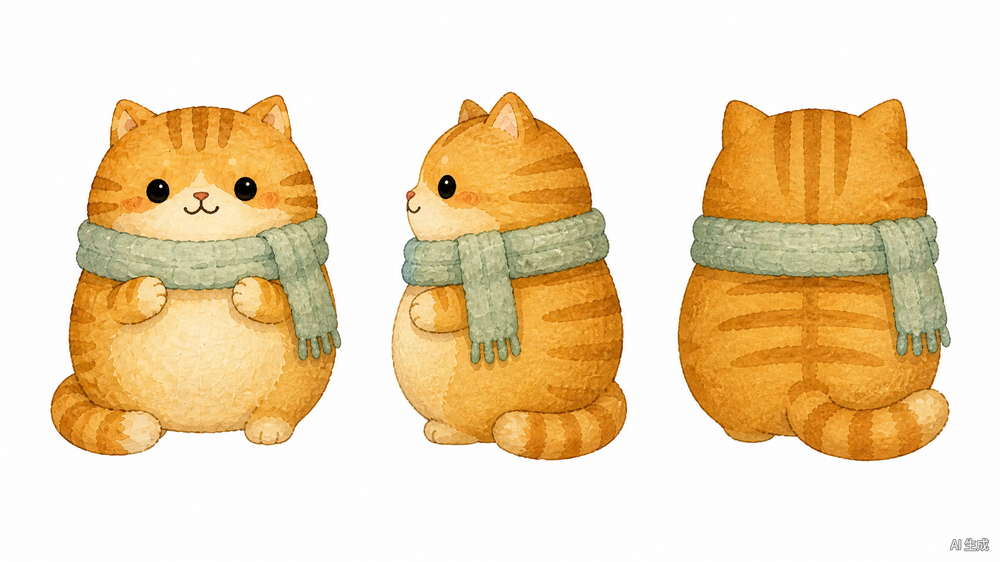

# 🐾 毛茸茸圆桌 · Fluffy Roundtable

> **在这儿刷知乎。刷完乱了，就问它们。**
> *它知道你刚才看了什么，也一直都在。*

知乎黑客松 S3 · 赛道 02（AI × 陪伴与交互）参赛作品。
100% 真实知乎开放平台 API 驱动的「模拟知乎 + 侧边刘看山伴侣小屋」一体式 Web 应用。

---

## 看一遍这版圆桌 · V6.1

点右下角正在写字的刘看山，窗沿就展开成小屋。猫头鹰飞上圆窗，呼噜猫和柴犬先后跑进来。等它们坐稳，第一句对话才出现。

<p align="center">
  
  
</p>

### 四位伙伴的原始三视图

依次是**刘看山、呼噜猫、考据猫头鹰、护短柴犬**。每张都是原始设定图，点图可放大看正面、侧面和背面的细节。

<p align="center">
  <a href="assets/turnarounds/liukanshan-turnaround-sheet.png"></a>
  <a href="assets/turnarounds/ginger-cat-turnaround-sheet.png"></a>
</p>
<p align="center">
  <a href="assets/turnarounds/owl-turnaround-sheet.png"></a>
  <a href="assets/turnarounds/shiba-turnaround-sheet.png"></a>
</p>

### 四位伙伴的动作立绘

刘看山伏案写字、举起放大镜、捧书阅读；呼噜猫从打盹到踱步，再追起蝴蝶。猫头鹰展翅、低头沉思、放声笑，柴犬则咧嘴笑、追皮球，最后趴下休息。

[](assets/action-poses/v1/overview.png)

[按角色查看和下载透明单图](assets/action-poses/v1/README.md) · [整套下载（ZIP）](assets/action-poses/v1/roundtable-action-poses-v1.zip?raw=true)

### 圆桌里怎么接话

呼噜猫说完，先从画面退下，猫头鹰再接过话。气泡留在原处，不催着你读下一句。


**[下载可点击原型](public/previews/roundtable-v6.1/index.html)**（GitHub 文件页点 **Download raw file**，双击下载的 HTML，无需安装或密钥） · [看 44.5 秒全程演示](docs/visual-target-v6.1/media/walkthrough.mp4) · [原始素材总索引](assets/README.md) · [定稿图、透明立绘与可编辑源文件](docs/visual-target-v6.1/README.md)

这是前端和动效的**设计目标**。原型使用两篇本地示例，不连知乎；下方正式应用的真实数据流程没有被替换。

## 核心体验（五步闭环）

1. **模拟知乎** — 真实热榜 / 站内搜索，点进问题可读真实回答正文、赞同数、权威度与精选评论
2. **静默陪伴** — 展开全文或视口停留 ≥2.5s，右下角刘看山悄悄记下（`readingTrail`，最多 5 篇）
3. **毛茸茸小屋** — 点开刘看山，大光幕拉出你刚刷过的真实帖子，四小只围炉开会
4. **3 分钟最小掌控卡** — 一句话结论 + 今天就能做的一件小事
5. **清醒猫咖手账** — 拍板后解锁主题小猫，连同结论与原帖链接存入 `localStorage`

## 四只圆桌成员

| 角色 | 职责 | 数据源 |
|---|---|---|
| 🐱 呼噜猫 | 先接住情绪，**严禁掺任何建议** | 当前浏览轨迹 |
| 🦉 考据猫头鹰 | 拆解原文、高亮话术陷阱、引站外客观对照 | `ContentText` + `global_search` |
| 🐕 护短柴犬 | 替你吐槽、挖评论区反方声音、重搜端出真实好帖 | `CommentInfoList` + 二次 `zhihu_search` |
| 🦊 刘看山 | 静默陪伴 + 最终收口 + 递出掌控卡 | 全局 |

---

## 本地运行

```bash
cp .env.example .env.local   # 填入 ZHIHU_ACCESS_SECRET
npm install
npm run dev                  # http://localhost:3100
npm run smoke                # 全链路冒烟（56 项）
```

**LLM 为可选增强**：未配置 `LLM_*` 时自动降级为规则引擎，四小只照常开会，Demo 永不白屏。

### 正式应用的绘本大图（不含上方已入库的原型素材）

`public/assets/images/` 与 `public/assets/ip/` 下的 7 个运行时文件没有重复提交；对应的场景原图和看山参考图保存在[原始美术目录](assets/README.md)。正式应用如果缺少这些展示文件，可以从归档或本地素材补齐：

```bash
# 方式 A：本地素材
cp "F:\图片\知乎\毛茸茸圆桌会\*.png" public/assets/images/
unzip -j "F:\图片\知乎\kanshan-three-views.zip" "看山三视图/*.jpg" -d public/assets/ip/

# 方式 B：仓库内已有等价的归档素材
#   assets/images/*.png（原尺寸，保留原图，不被 WebP 替换）
#   assets/images/*.webp（1600×900 压缩版）
#   assets/ip/kanshan-*.jpg（同源刘看山三视图）
```

细节见 [`HANDOVER.md`](HANDOVER.md) §六。

## 架构要点

- **无数据库**（适配知乎 AiWorks）：服务端仅进程内 TTL 缓存，用户数据全在 `localStorage`
- **额度防爆仓**：`hot_list` 15 分钟缓存、搜索 30 分钟缓存、圆桌结果 30 分钟缓存；额度 <15% 自动延长 TTL ×4
- **每轮圆桌最多消耗 2 次搜索额度**（`global_search` ×1 + `zhihu_search` ×1）
- **防幻觉三重保险**：素材编号 `READ_x`/`EXT_x`/`NEW_x` → 引文逐字校验是否为原文子串 → `curatedSources` 由服务端按索引回填真实 URL，LLM 永不生成链接

## 三条台词红线（服务端强制过滤）

1. 永远说「它没在回答你此刻的问题」，**绝不说某篇知乎回答写得烂**
2. 呼噜猫第一句只接情绪，出现「不过/但是/你可以/建议你」即丢弃该条
3. 绝不承诺「剩下的都没问题」

## 目录

```
src/
├── app/
│   ├── page.tsx                      # 模拟知乎 + 侧边刘看山 + 小屋浮层
│   └── api/
│       ├── zhihu/{hot,search,quota}  # 知乎开放平台代理（含缓存与降级）
│       └── roundtable/{analyze,follow-up}
├── lib/
│   ├── zhihu-client.ts               # Bearer + Timestamp 封装、字段归一化
│   ├── cache.ts                      # 进程内 TTL 缓存
│   ├── llm.ts                        # 圆桌编排 Prompt + 防幻觉校验
│   ├── fallback-engine.ts            # 规则兜底引擎（LLM 不可用时独立撑场）
│   └── storage.ts                    # localStorage：轨迹 / 手账
└── components/{zhihu-sim,companion,cabin,journal}/
```

## 仓库归档（策划 · 素材 · 原型）

仓库同时保留项目早期的策划全案、Image2 素材与 HTML 动效原型，均不影响 Next.js 应用运行：

| 路径 | 内容 |
|---|---|
| [`docs/08-项目介绍与素材索引（原 README 归档）.md`](docs/08-项目介绍与素材索引（原 README 归档）.md) | 完整项目介绍、角色设定与素材索引（原仓库首页） |
| [`docs/`](docs/) | 01–07：宣传通稿、策划与技术架构全案、UI 动效指南、分镜与三视图提示词、Galgame 差分立绘、11.16 拉门小屋进度 |
| [`docs/visual-target-v6.1/`](docs/visual-target-v6.1/) | 当前交互目标：认可的角色立绘、动效、可重建的单页原型 |
| [`prototypes/`](prototypes/) | 早期 3 个浏览器直接打开的交互动效原型（5 步 Demo / Galgame v1 / 拉门小屋聊天室） |
| [`assets/`](assets/) | 12 张去背多视角图、四角色原始三视图、12 张透明动作立绘、界面预览、概念图与刘看山 IP 素材 |

> 只看图不必克隆仓库：可直接在本页预览，或单独下载上方的动作素材包。

## 进度

- **Phase 1（P0）** ✅ 真实 API 端到端闭环已跑通
- **Phase 2（P1）** 待办：OAuth 登录模块、决断卡图片导出
- **Phase 3（P2）** 待办：AiWorks 公网部署、移动端实测、正式应用演示视频
