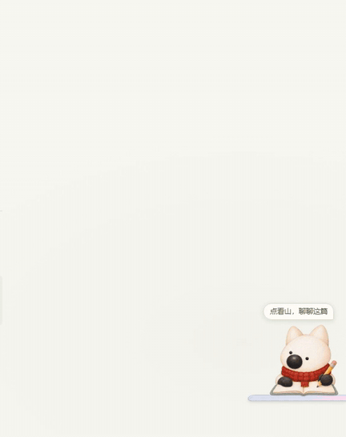

# 原始美术与动效

这里把**画角色用的原图**、**从窗沿开聊的动画**和**聊天框参考画面**分开列出。链接指向原文件，不是重新导出的缩略图。

## 四位伙伴的原始三视图

| 角色 | 三视图原图（PNG） |
|---|---|
| 刘看山 | [正面、侧面、背面](turnarounds/liukanshan-turnaround-sheet.png) |
| 呼噜猫 | [正面、侧面、背面](turnarounds/ginger-cat-turnaround-sheet.png) |
| 考据猫头鹰 | [正面、侧面、背面](turnarounds/owl-turnaround-sheet.png) |
| 护短柴犬 | [正面、侧面、背面](turnarounds/shiba-turnaround-sheet.png) |

[四只同框参考](turnarounds/snow-scarf-4animals-ref.jpg) · [按角色和角度拆好的透明图](sprites/) · [刘看山 IP 参考图](ip/)。三视图是人设参考，不用聊天态立绘代替。

## 四位伙伴的动作立绘

[查看十二个动作及各自的透明原图](action-poses/v1/README.md) · [四角色动作总览](action-poses/v1/overview.png) · [下载整套 PNG（ZIP）](action-poses/v1/roundtable-action-poses-v1.zip?raw=true)。这一组是基于上方三视图绘制的静态姿势，和下方的开场动画分别留档。

## 从看山的窗沿到小屋对话框

[看完整开场原动图（GIF）](../docs/visual-target-v6.1/media/01-open.gif)：点正在窗沿写字的看山，窗沿撑开成屋，猫头鹰飞进来，猫与柴犬跑进来；伙伴落座后出现第一位说话者和气泡。这段是开场，不是单独的角色换人片段。

- [早期「从窗沿到圆桌」原动图（V2）](animations/window-to-cabin-v2.gif)：保留当时的入屋动作，和上面的开聊定稿并存。
- [后续两位角色如何交接发言](../docs/visual-target-v6.1/media/03-speaker-handoff.gif) · [44.5 秒全程实录](../docs/visual-target-v6.1/media/walkthrough.mp4) · [可点击的离线原型](../public/previews/roundtable-v6.1/index.html)。

## 早期四张场景原画

下面每对链接指向同一场景的两种文件：原尺寸 PNG 用于设计，轻量 WebP 用于展示。两种都保留。

| 场景 | 原尺寸 PNG | 轻量 WebP |
|---|---|---|
| 篝火圆桌 | [原图](images/01-campfire-roundtable.png) | [压缩版](images/01-campfire-roundtable.webp) |
| 雪地星光 | [原图](images/02-snow-stardust.png) | [压缩版](images/02-snow-stardust.webp) |
| 光幕会议 | [原图](images/03-screen-meeting.png) | [压缩版](images/03-screen-meeting.webp) |
| 小屋背影 | [原图](images/04-hq-backview.png) | [压缩版](images/04-hq-backview.webp) |

## 聊天框和窗沿的原始参考

[看山双爪扒框](previews/ui-front-grip-fox-v1.png) · [挥手的看山](previews/ui-wave-greet-fox-v1.png) · [初版云朵聊天框](previews/pastel-cloud-panel-v1.png) · [早期小屋全景](previews/cabin-chat-room-v2.png)。

下图是收到的**猫头鹰发言截图原件**：话题为「学 AI，要先上课还是先做项目？」，下方是聊天记录 02 / 04。它用于对齐立绘、气泡和文字的位置，是独立参考图，不会替换可交互页面。

**留档约定：** 已收录的原图、动图和历史原型保留原文件与路径。后续调整请另存为新版本，不删除、覆盖或用压缩版替换旧素材。
