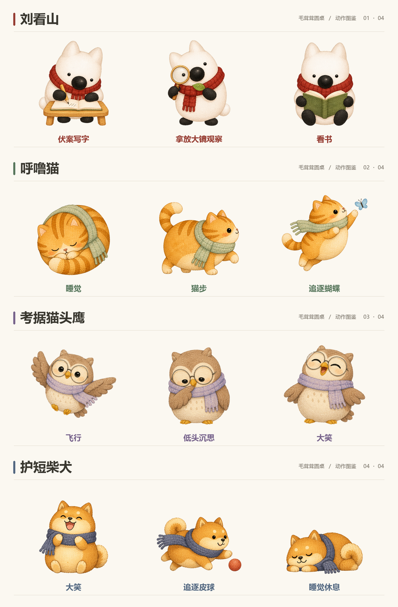

# 四位伙伴的动作立绘 · V1

每个动作都是一张独立的 **768 × 768 透明 PNG**，可以叠在聊天框或小屋背景上。总览和四张角色预览用浅色背景方便看细节；它们不是动画分帧。

| 角色 | 角色预览 | 动作一 · 透明 PNG | 动作二 · 透明 PNG | 动作三 · 透明 PNG |
| --- | --- | --- | --- | --- |
| 刘看山 | [三图并排](previews/liukanshan.png) | [伏案写字](poses/liukanshan-writing.png) | [拿放大镜观察](poses/liukanshan-magnifier.png) | [看书](poses/liukanshan-reading.png) |
| 呼噜猫 | [三图并排](previews/ginger-cat.png) | [睡觉](poses/ginger-cat-sleeping.png) | [猫步](poses/ginger-cat-walking.png) | [追逐蝴蝶](poses/ginger-cat-chasing-butterfly.png) |
| 考据猫头鹰 | [三图并排](previews/owl.png) | [飞行](poses/owl-flying.png) | [低头沉思](poses/owl-thinking.png) | [大笑](poses/owl-laughing.png) |
| 护短柴犬 | [三图并排](previews/shiba.png) | [大笑](poses/shiba-laughing.png) | [追逐皮球](poses/shiba-chasing-ball.png) | [睡觉休息](poses/shiba-resting.png) |

[下载整套素材（ZIP，保留中文文件名）](roundtable-action-poses-v1.zip?raw=true) · [查看作为人设依据的原始三视图](../../turnarounds/) · [返回项目首页](../../../README.md)
