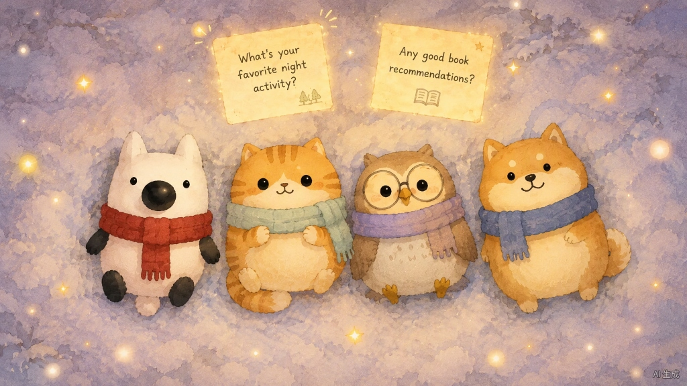
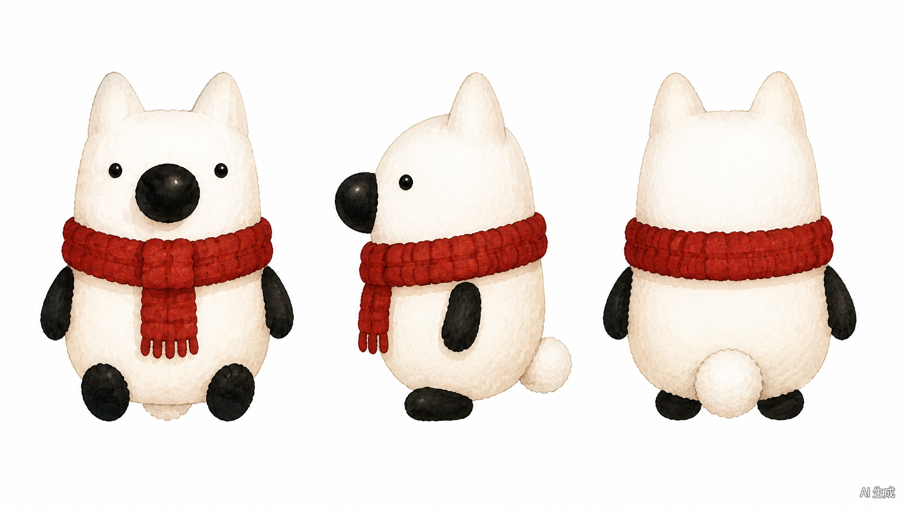
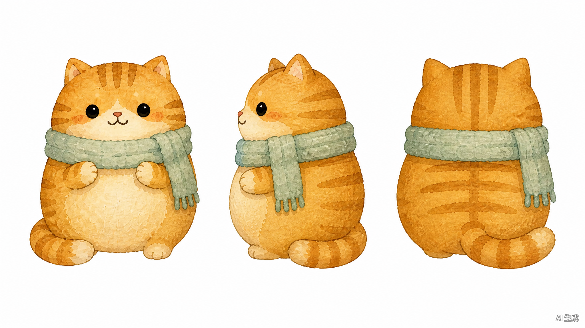
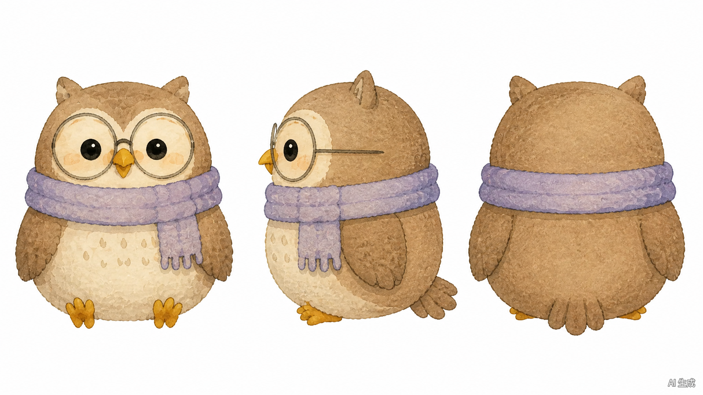
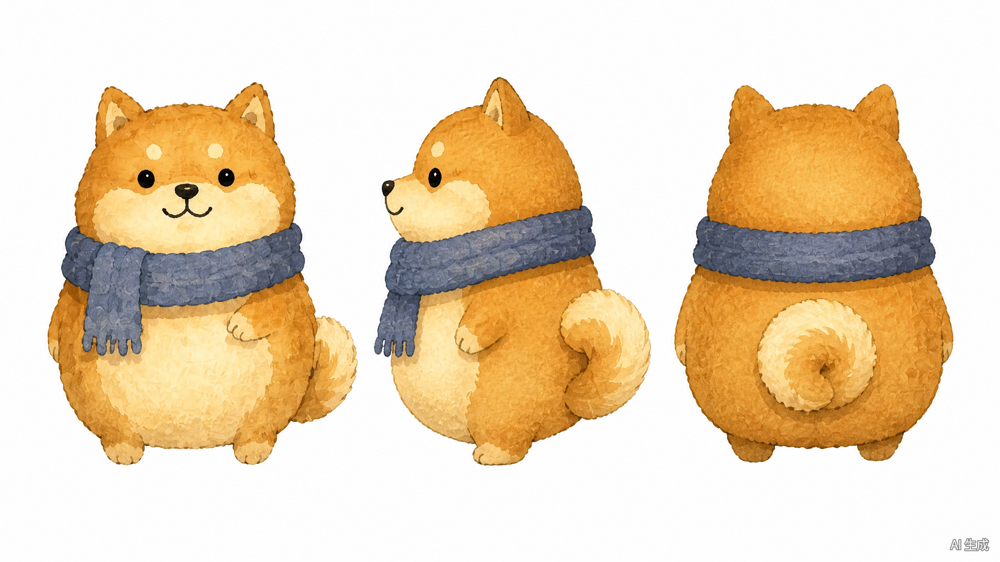
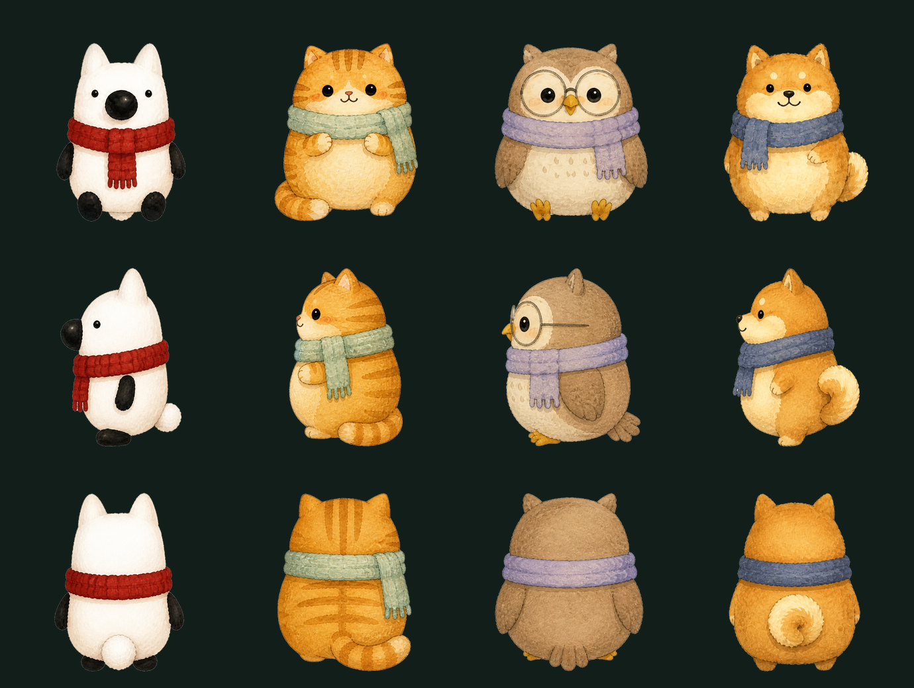
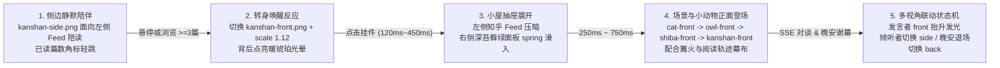

# 毛茸茸圆桌（Fluffy Roundtable）— Image2 三视图素材、多视角立绘与前端动画实现指南

> **核心原则**：不要直接用“带文字和背景的大整图”铺底，也不要拿未裁切的三视图直接裁圆形按钮；必须采用 **「Image2 统一围巾水彩设定 + 三视角（正/侧/背）独立透明精灵切图 + 纯代码分层动画」**。

---

## 一、初版常见视觉踩坑诊断

1. **侧边触发器问题**：若直接把 [`assets/ip/kanshan-three-views.jpg`](../assets/ip/kanshan-three-views.jpg)（含灰底、黑色垂直分割线、三视角并排）放进圆形悬浮按钮，会带出割裂黑线，也无法做出“侧身陪读 → 转身挥手 → 跃出推门”动效。
2. **小屋弹窗背景问题**：若直接将带文字的 [`assets/images/03-screen-meeting.webp`](../assets/images/03-screen-meeting.webp) 作为整个弹窗背景，图中的手绘字母与标题会透过半透明卡片和真实前端文字叠字打架；只放系统 Emoji（🐱 🦉 🐕 🦊）也缺乏绘本陪伴感。
3. **气泡文字对比度问题**：深色半透明气泡如果继承深黑灰色正文，在暗森林底色下几乎不可读，正文必须使用高对比度的暖米白 `#F5F1E8` 配深苔藓卡片 `#1B2E26`，或浅米纸卡片配深棕文字。

---

## 二、Image2 定稿三视图原图与 5 层舞台结构

本套视觉资产统一采用用户在 **Image2** 生成的「手绘水彩毛绒比例 + 各色粗针织流苏围巾」定稿，确保 4 只小动物在同一镜头语言下协调共处。

### 1. 雪地围巾群体定妆参考（1024 × 576）

### 2. 四角色 Image2 三视图设定原图（2048 × 1152）

| 角色 | 围巾与特征 | 原始三视图档案 |
| :--- | :--- | :--- |
| **刘看山（小白狐）** | 砖红色针织流苏围巾、亮黑椭圆大鼻与四肢 | [`assets/turnarounds/liukanshan-turnaround-sheet.png`](../assets/turnarounds/liukanshan-turnaround-sheet.png) |
| **呼噜猫（小橘猫）** | 浅灰豆绿针织围巾、温暖虎斑橘毛与圆脸 | [`assets/turnarounds/ginger-cat-turnaround-sheet.png`](../assets/turnarounds/ginger-cat-turnaround-sheet.png) |
| **考据猫头鹰** | 大圆细框眼镜、浅香芋紫围巾、斑点胸羽 | [`assets/turnarounds/owl-turnaround-sheet.png`](../assets/turnarounds/owl-turnaround-sheet.png) |
| **护短柴犬** | 雾霾蓝针织流苏围巾、奶油眉毛点与卷尾 | [`assets/turnarounds/shiba-turnaround-sheet.png`](../assets/turnarounds/shiba-turnaround-sheet.png) |

### 3. 前端 5 层纯净动画结构（无背景文字干扰）

1. **夜色底色与微光层**：纯 CSS 深苔藓绿渐变（`#0F1A16` → `#182923`）+ 漂浮萤火虫粒子（或切换 [`docs/06-Galgame差分立绘与温馨背景及劝休指南.md`](06-Galgame差分立绘与温馨背景及劝休指南.md) 中的温馨室内背景）。
2. **已读轨迹投影幕布层**：暖琥珀发光卡片实时渲染真实抓取到的知乎浏览轨迹。
3. **中央篝火层**：SVG/CSS 轻摇曳火苗 + 底部暖光晕。
4. **4 只独立多视角角色与气泡层**：使用裁切去背后的独立透明 PNG（支持正/侧/背切换），依次弹性登场并按当前发言者放大高亮。
5. **底部掌控卡层**：圆桌收尾后滑出「3 分钟最小掌控卡」与琥珀 CTA 按钮。

---

## 三、12 张透明 PNG 多视角精灵素材（Edge Flood-Fill 精抠）

从上方 4 张 Image2 `2048 × 1152` 纯白底三视图中，采用**从外边缘向内广度优先泛洪（Edge-Seeded BFS Flood-Fill）+ 连通域去杂斑**算法，统一缩放至高 `680px` 并彻底剥离白底与右下角 `"AI 生成"` 水印，同时完整保留刘看山雪白身体、猫头鹰镜片高光与动物浅奶油肚子，无白孔、无白边。

### 深苔藓绿背景实测效果（`#121E1A`）

可直接复制到前端项目 `public/sprites/` 的 12 个透明 PNG 资产（每只角色均含**正视 / 侧视 / 背视**三态）：

| 角色 | 正视（Front） | 侧视（Side） | 背视（Back） |
| :--- | :--- | :--- | :--- |
| **刘看山** | [`kanshan-front.png`](../assets/sprites/kanshan-front.png) (`486 × 680`) | [`kanshan-side.png`](../assets/sprites/kanshan-side.png) (`457 × 680`) | [`kanshan-back.png`](../assets/sprites/kanshan-back.png) (`500 × 680`) |
| **呼噜猫** | [`cat-front.png`](../assets/sprites/cat-front.png) (`538 × 680`) | [`cat-side.png`](../assets/sprites/cat-side.png) (`431 × 680`) | [`cat-back.png`](../assets/sprites/cat-back.png) (`520 × 680`) |
| **考据猫头鹰** | [`owl-front.png`](../assets/sprites/owl-front.png) (`575 × 680`) | [`owl-side.png`](../assets/sprites/owl-side.png) (`523 × 680`) | [`owl-back.png`](../assets/sprites/owl-back.png) (`570 × 680`) |
| **护短柴犬** | [`shiba-front.png`](../assets/sprites/shiba-front.png) (`542 × 680`) | [`shiba-side.png`](../assets/sprites/shiba-side.png) (`479 × 680`) | [`shiba-back.png`](../assets/sprites/shiba-back.png) (`508 × 680`) |

---

## 四、5 段式前端动画时间轴、多视角切换与可点击原型

- **5 步交互动画原型（已替换为 Image2 立绘）**：[`prototypes/fluffy-roundtable-5step-demo.html`](../prototypes/fluffy-roundtable-5step-demo.html)
- **视觉剧场与劝休原型（已替换为 Image2 立绘）**：[`prototypes/fluffy-roundtable-galgame-v1.html`](../prototypes/fluffy-roundtable-galgame-v1.html)

### 给前端实现的 6 个核心约束（Framer Motion）

1. 在客户端交互组件顶部添加 `"use client"` 并引入 `framer-motion`。
2. 彻底移除 [`kanshan-three-views.jpg`](../assets/ip/kanshan-three-views.jpg) 圆形头像、[`03-screen-meeting.webp`](../assets/images/03-screen-meeting.webp) 铺底背景图以及所有系统字符 Emoji（🐱🦉🐕🦊）。
3. 背景全部使用纯 CSS 渐变 + 轻飘微粒子或无字纯景暖色室内插画，确保前景文字清晰可读。
4. 充分利用三视角素材做“方向感演出”：侧边伴侣待机使用 [`kanshan-side.png`](../assets/sprites/kanshan-side.png) 面向左边的文章列表，悬停/唤醒时丝滑交叉淡入为正视 [`kanshan-front.png`](../assets/sprites/kanshan-front.png)，触发「听劝去休息」晚安动画时切至 [`kanshan-back.png`](../assets/sprites/kanshan-back.png) 留一盏暖灯守夜。
5. 4 只动物采用交错入场（`delay` 依次为 `0.35s / 0.48s / 0.60s / 0.72s`），配合轻量持续呼吸动画。
6. 由当前发言角色 `activeSpeaker` 驱动舞台高亮（发言者 `front` 放大高亮 `scale: 1.08, y: -6` + 暖金色 `drop-shadow`，旁听角色可轻微转向 `side` 并降低亮度）。
