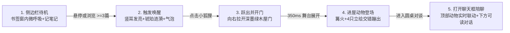
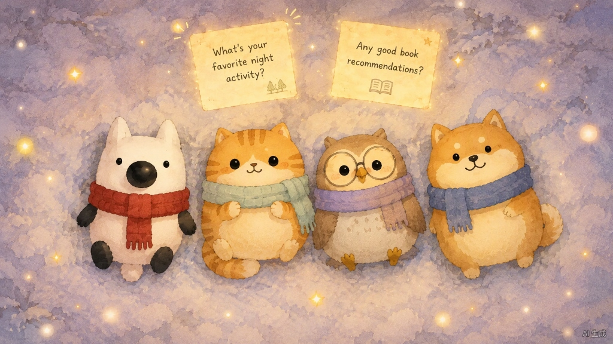

# 毛茸茸圆桌 — 五步交互分镜与四角色三视图生图提示词全集

> **文档用途**：汇总界面 5 步交互状态分镜（待机 → 唤醒 → 跃出开门 → 动物登场 → 聊天陪聊）以及四只毛茸茸小动物的三视图（正视/侧视/背视）生图提示词。所有提示词均已做降敏、去品牌词化处理，方便直接用于各类生图工作台。

---

## 一、5 步动画状态机总览



可配合交互 Demo 一起查看动画节奏：[`prototypes/fluffy-roundtable-5step-demo.html`](../prototypes/fluffy-roundtable-5step-demo.html)

---

## 二、5 步界面分镜生图提示词（UI Storyboard Prompts）

> 垫图建议：生分镜 1~3 可附带 Image2 定稿切图 [`assets/sprites/kanshan-front.png`](../assets/sprites/kanshan-front.png) 与 [`assets/sprites/kanshan-side.png`](../assets/sprites/kanshan-side.png)；生分镜 4~5 可附带四动物雪地定妆参考 [`assets/turnarounds/snow-scarf-4animals-ref.jpg`](../assets/turnarounds/snow-scarf-4animals-ref.jpg) 及 `assets/sprites/*-front.png`。

### 1. 侧边栏待机状态
```text
High-resolution 16:9 desktop UI mockup based on a clean light-mode Q&A reading feed (white top search header with blue search button, crisp white article cards on left-center). Nestled cleanly on the wide empty right whitespace margin sits a floating dark forest mossy-green (#182923) rounded bookmark companion nook with a thin warm wood-gold trim and soft shadow. Inside sits a cute 2D hand-painted watercolor white arctic fox (big black oval nose, black arms and feet, cozy red knitted scarf), peacefully blinking softly while looking down at a tiny spiral notebook in its paws. Subtle breathing arc motion lines and a warm cream badge below reading "安静陪读中 · 已记 2 篇". Clean minimalist SaaS + cozy storybook aesthetic.
```

### 2. 触发唤醒状态
```text
16:9 UI interaction state continuing the clean light-mode web feed and right-side dark mossy-green (#182923) bookmark companion nook. Depict the exact Wake-Up Trigger moment: a clean cursor hovers nearby as two glowing warm amber ripple rings and tiny golden fireflies radiate softly around the dock. The 2D watercolor white arctic fox (black oval nose, black limbs, red knitted scarf) perks both ears straight up with bright sparkling eyes and waves one paw cheerfully toward the reader. A crisp cream speech bubble floats beside the dock reading "翻了 5 篇有点乱？点我进屋聊聊", while the bottom capsule glows warm amber reading "✨ 唤醒圆桌".
```

### 3. 唤醒后跃出并推开小屋子
```text
16:9 UI transition keyframe showing the exact click interaction moment. On the left, the bright web reading feed gently dims under a warm twilight backdrop overlay. From the right edge, a dark forest mossy-green (#121E1A) slide-over drawer framed like a warm wooden cabin doorway glides smoothly open, spilling warm amber campfire light and cozy silhouettes of friendly little animals waiting inside. At the doorway threshold, the 2D watercolor white fox hops forward joyfully in mid-bounce with a golden sparkle motion arc under its feet and one paw gesturing welcomingly inside. High-craft Dribbble UI motion aesthetic.
```

### 4. 打开小屋子：四只小动物围炉登场
```text
Clean dark-forest UI dashboard mockup for an opened cozy cabin modal over a pure mossy-green gradient (#121E1A to #182923) with floating golden fireflies and completely uncluttered clean background. Top header reads "🔥 毛茸茸圆桌" with a clean close icon. Upper tray features a warm cream-bordered card group titled "你刚刚在深夜翻过的 5 篇" holding crisp readable white post summary cards, followed by three dark compact telemetry meters: "干货密度 44", "情绪煽动 11", "引流嫌疑 0". Beneath the meters sits a glowing Campfire Entrance Stage: a stylized warm vector campfire in the center with four isolated 2D storybook watercolor animals mid-pop-in — chubby orange tabby cat holding a mug, round-glasses brown owl holding a wooden twig, tan Shiba Inu wearing a slate-blue scarf, and white arctic fox wearing a red scarf with a tiny notebook — with soft bounce rings underneath.
```

### 5. 打开聊天框：上方伴侣联动 + 下方高对比度对话流
```text
Clean dark-forest AI companion chat UI design (#121E1A pure mossy-green background). Top 20% features a cozy compact Live Companion Stage Rail: a small glowing campfire in the center flanked by four 2D watercolor animals (orange tabby cat, round-glasses brown owl, blue-scarf Shiba Inu, red-scarf white arctic fox) perched comfortably facing the conversation below. The currently speaking brown Owl is highlighted — slightly scaled up, gently elevated, framed with a soft amber glow and crisp mini pill "推眼镜核对" above its head — while the other three tilt their heads attentively. Below sits an ultra-legible chat stream: rounded watercolor animal avatars paired with solid dark moss message bubbles (#1C3028) displaying bright warm cream-white text (#F5F1E8), plus an embedded warm ivory quote card ("原帖 ↗") with sharp dark ink text. Anchored at the bottom is a clean wooden-trimmed reply input bar with a glowing amber Send button and quick emotion chips.
```

---

## 三、四只小动物三视图生图提示词与 Image2 定稿索引

以下提示词严格对应四只小动物的雪地围巾版统一比例（1:1 蛋形水彩毛绒比例 + 各色粗针织流苏围巾），生图时参考图位于 [`assets/turnarounds/snow-scarf-4animals-ref.jpg`](../assets/turnarounds/snow-scarf-4animals-ref.jpg)；4 只小动物通过 Image2 生成的 `2048×1152` 成品三视图均已归档至 [`assets/turnarounds/`](../assets/turnarounds/)，去背多视角透明立绘见 [`assets/sprites/`](../assets/sprites/)。



| 角色 | Image2 原始三视图（2048 × 1152） | 裁切后透明精灵（Front / Side / Back） |
| :--- | :--- | :--- |
| 刘看山（红围巾小白狐） | [`liukanshan-turnaround-sheet.png`](../assets/turnarounds/liukanshan-turnaround-sheet.png) | [`kanshan-front.png`](../assets/sprites/kanshan-front.png) / [`kanshan-side.png`](../assets/sprites/kanshan-side.png) / [`kanshan-back.png`](../assets/sprites/kanshan-back.png) |
| 呼噜猫（浅豆绿围巾小橘猫） | [`ginger-cat-turnaround-sheet.png`](../assets/turnarounds/ginger-cat-turnaround-sheet.png) | [`cat-front.png`](../assets/sprites/cat-front.png) / [`cat-side.png`](../assets/sprites/cat-side.png) / [`cat-back.png`](../assets/sprites/cat-back.png) |
| 考据猫头鹰（大圆眼镜 · 浅紫围巾） | [`owl-turnaround-sheet.png`](../assets/turnarounds/owl-turnaround-sheet.png) | [`owl-front.png`](../assets/sprites/owl-front.png) / [`owl-side.png`](../assets/sprites/owl-side.png) / [`owl-back.png`](../assets/sprites/owl-back.png) |
| 护短柴犬（雾霾蓝围巾） | [`shiba-turnaround-sheet.png`](../assets/turnarounds/shiba-turnaround-sheet.png) | [`shiba-front.png`](../assets/sprites/shiba-front.png) / [`shiba-side.png`](../assets/sprites/shiba-side.png) / [`shiba-back.png`](../assets/sprites/shiba-back.png) |

### 1. 小白狐（砖红色流苏围巾）三视图
```text
Character turnaround sheet with 3 views (Front view, Left side profile view, Back view) of the chubby white arctic fox from the far left of the reference image, arranged horizontally at identical scale and baseline in 16:9 aspect ratio on a clean flat solid pure white background (#FFFFFF) with generous spacing, smooth lighting, and clear outlines. Strictly preserve the 2D hand-painted storybook watercolor + gouache texture, plump egg-shaped plush proportions, glossy black button eyes with tiny white highlight, oversized glossy black oval nose, solid dark charcoal-black stubby arms and rounded feet, and thick crimson-red ribbed knitted scarf with fringed tassels.
- Front view: symmetrical chubby seated pose facing forward, crimson scarf ends hanging down center chest, tiny fluffy white tail tip peeking below;
- Left side profile view: clearly showing the protruding white muzzle tipped by the big glossy black oval nose, pointed ear silhouette, continuous red knitted scarf around neck, stubby black arm on side, and small round puffy white pom-pom tail sticking out at lower back;
- Back view: white pointed ears from behind, continuous red scarf wrapping back of neck, smooth snow-white chubby back, and centered fluffy round white tail at lower back.
```

### 2. 小橘猫（浅灰豆绿流苏围巾）三视图
```text
Character turnaround sheet with 3 views (Front view, Left side profile view, Back view) of the chubby orange tabby cat (second from left in the reference image), arranged horizontally at matching height and baseline in 16:9 aspect ratio on a clean flat solid pure white background (#FFFFFF). Strictly keep the 2D storybook watercolor style, plump rounded plush proportions, warm golden-orange fur with brown tabby stripes, soft cream-beige muzzle and belly patch, rosy cheeks, glossy black button eyes, tiny "w" smile, and pale sage-mint green knitted scarf with tassels draped slightly to viewer's right.
- Front view: cute paws tucked against chest, striped tabby tail curling toward lower left;
- Left side profile view: plump rounded cheek profile, small cat nose, curved tabby stripes down back, sage-green knitted scarf circling neck, cream belly curve, thick ringed tabby tail curving behind;
- Back view: back of triangular cat ears, harmonious symmetrical orange-brown tabby stripes down head and plump back, continuous sage-green scarf around back of neck, curled ringed tabby tail peeking out at bottom.
```

### 3. 小猫头鹰（大圆眼镜 + 浅香芋紫围巾）三视图
```text
Character turnaround sheet with 3 views (Front view, Left side profile view, Back view) of the chubby brown owl (third from left in the reference image), arranged horizontally at matching scale and baseline in 16:9 aspect ratio on a clean flat solid pure white background (#FFFFFF). Strictly preserve the 2D hand-painted watercolor aesthetic, plump egg-shaped silhouette, warm cocoa-brown back feathers, subtle small head tufts, cream heart-shaped face, soft speckled chest feathers, oversized thin dark-rimmed round spectacles over glossy black button eyes, tiny golden-orange beak, tiny yellow webbed feet, and soft muted lavender-purple knitted scarf with tasseled end draped on viewer's right.
- Front view: symmetrical plump frontal pose with large round glasses and lavender scarf;
- Left side profile view: rounded teardrop body profile, subtle golden beak tip and thin eyeglass temple arm tracing cleanly along the side of the head, folded cocoa-brown wing tucked snugly on the flank, dusty-purple scarf circling the neck, short tail feathers peeking out low in back;
- Back view: back of small ear tufts, smooth watercolor cocoa-brown back and symmetrically folded wings, continuous muted lavender scarf wrapping around back of neck, short layered brown tail feathers at base.
```

### 4. 小柴犬（雾霾蓝流苏围巾）三视图
```text
Character turnaround sheet with 3 views (Front view, Left side profile view, Back view) of the chubby golden-tan Shiba Inu (far right of the reference image), arranged horizontally at matching scale and baseline in 16:9 aspect ratio on a clean flat solid pure white background (#FFFFFF). Strictly preserve the 2D storybook watercolor texture, plump rounded plush proportions, warm golden-tan fur, signature pair of small cream eyebrow dots, soft cream cheeks/muzzle/belly, small black nose with cheerful "w" smile, upright triangular ears, stubby paws, and slate-denim blue ribbed knitted scarf with fringed end draped to viewer's left.
- Front view: plump frontal pose showing cream eyebrow dots, slate-blue scarf, fluffy curled tail tip peeking on the side;
- Left side profile view: cute slightly protruding rounded Shiba snout with black nose tip, erect ear profile, continuous blue knitted scarf, clean tan-to-cream fur boundary, and plump curled fluffy tan-and-cream doughnut Shiba tail arching over the lower back;
- Back view: back of triangular tan ears, warm watercolor golden-tan back fur, continuous slate-blue scarf around neck, iconic tightly curled fluffy Shiba tail centered on the lower back.
```
