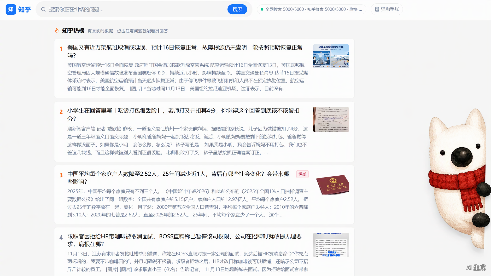
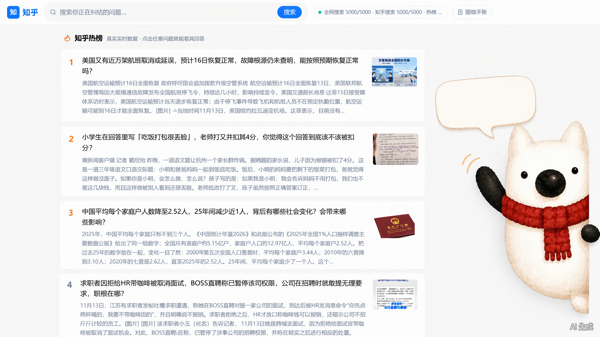
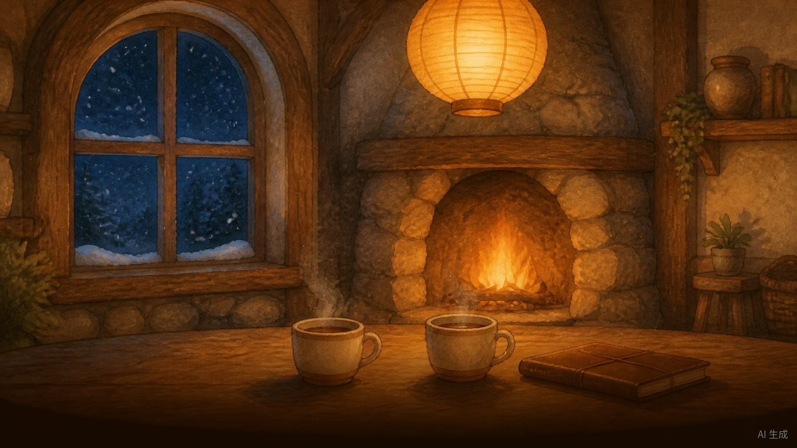
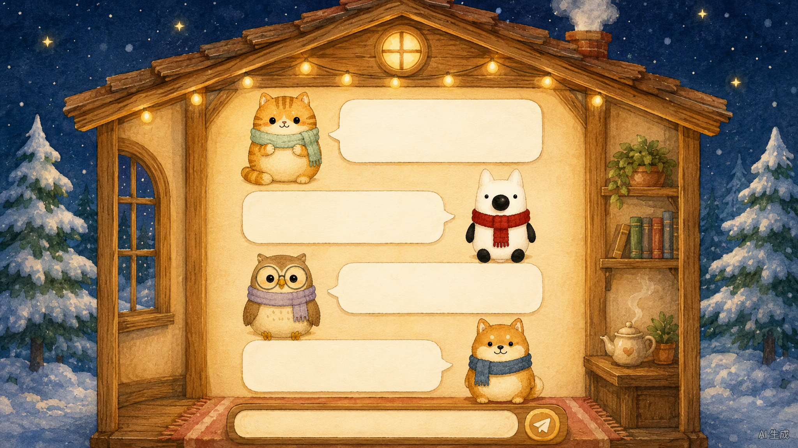

# 毛茸茸圆桌 — 侧边扒框互动与拉门小屋聊天室设计进度（2026-11-16）

> **文档用途**：存档 2026-11-16 视觉探索与互动原型最新进度，包含 **Image 2 实景 UI 预览图**、从视觉评审中提炼的关键修正规则、新版可交互「拉门小屋聊天室」原型及配套升级生图提示词。

---

## 一、阶段 1：网页右侧正脸扒框 → 久未互动挥手唤醒

### 已验收 Image 2 实景预览图

1. **平时浏览态：正脸朝屏幕扒着右边框悄声探头**  
   

2. **久未互动态：多探半身并高举小黑爪挥手打招呼**  
   

### 关键视觉踩坑与修正心得

- **严禁使用三视图里的纯 90° 侧脸去扒边框**：初版测图一度调出侧视图朝左盯空白边，不仅遮住一只眼，也没有“看着用户本人”的陪伴感；提示词必须明确指定**仅使用三视图最左侧的正脸朝向（两只亮黑豆眼 + 居中大黑鼻完整正对屏幕外用户）**。
- **抹除原页面旧圆形挂件**：提示词里明确指令移除旧版右下角深色圆环头像与粉色浮标，避免画面同时出现两只重复吉祥物。
- **保护正文像素**：强调保持左侧文章列表真实文字与顶部搜索栏完全不动，确保产品演示图里的阅读正文锐利可读。

---

## 二、阶段 2：点开白狐拉开「带烟囱温暖小屋聊天室」

### 1. 深夜壁炉茶屋无字舞台底图（Image 2 定稿）



### 2. 带烟囱屋顶小屋聊天室初版探索稿（Image 2 v2）



### 3. 从 v2 探索稿总结出的 3 项核心定调修正（已落实到互动原型与 v3 提示词）

| 维度 | v2 探索稿问题 | 正确产品设计与叙事定调 |
| :--- | :--- | :--- |
| **背景关系** | 屋外是孤立的蓝夜雪景松树林 | **绝非雪景**；背景须是**柔和压暗的原浅色问答网页**，右侧由红围巾白狐亲自**从右边框拉出一座温暖木屋抽屉** |
| **立绘尺寸与姿态** | 四只小动物过大、直立僵硬贴在墙上 | 立绘缩小至轻盈陪聊尺寸（前端约 `64px` 高），给出**捧热茶歪头、抬翅推圆眼镜、前爪撑桌打气、门口扶框抱笔记本迎客**的自然生活态 |
| **气泡叙事例子** | 气泡完全留白，未体现项目灵魂 | 直接围绕 **「AI 时代普通人该如何学习才不焦虑」** 展开反焦虑四拍拆解：共情刹车 → 拆穿贩卖恐吓/卖课套路 → 给 1 步接地气做法 → 便签劝休 |

---

## 三、最新可点击交互原型（已全部落实上方设计）

- **拉门小屋聊天室 HTML 原型**：[`prototypes/fluffy-roundtable-cottage-chat.html`](../prototypes/fluffy-roundtable-cottage-chat.html)
  - 左侧保留压暗的「AI 时代普通人该如何学习？」模拟真实问答网页（支持点右上角/白狐切换「待机扒框态 ↔ 拉开带烟囱暖木屋群聊态」）；
  - 小屋内部为暖蜂蜜客厅（屋顶砖烟囱冒烟、暖光小串灯、书架、茶壶、无任何雪景），4 只小尺寸自然姿态的 Image 2 立绘分别连接专属对话气泡；
  - 支持点击任意动物立绘切换正/侧/背三视图，支持 `@点名` 快捷提问与自由输入发送消息。

---

## 四、配套 Image 2 v3 升级提示词（拉门小屋 + 反焦虑学习示例）

> 在 Image 2 同时上传：**图1（浅色网页截图） + 图2（`cabin-chat-room-v2.png` 小屋屋顶画风） + 图3（四动物定妆参考）**，严格去品牌词：

```text
16:9 高质感产品 UI 场景预览插画，采用温暖细腻的 2D 手绘水彩绘本与现代网页结合的视觉风格，严格禁止出现任何雪地、冬夜或松树林：

1. 背景构图（压暗的真实网页 + 右侧被拉开的小屋）：
- 画面左半部分清晰可见参考图1的干净浅色问答网页界面（顶部搜索框写着“AI时代普通人怎么学”，下方卡片讨论相关学习困惑），整个左半网页笼罩着一层温和柔暗的半透明遮罩，一眼看得出后面是一个正在浏览的真实网页；
- 画面右半部分（占约 60% 宽度）是从网页右侧边缘顺滑拉开的一座温馨木质小屋抽屉：沿用图2的尖顶木瓦屋顶、冒着淡淡白烟的红砖烟囱、发光圆形阁楼窗与屋檐暖色小串灯；屋框边缘站着图3那只砖红色针织围巾小白狐（大黑椭圆鼻子、黑色小短手），正用一只小黑爪拉着木屋左侧门框、微笑着微侧身做出“拉开门欢迎你进来”的自然活泼姿势。

2. 屋内地暖聊天室与“缩小且姿态自然”的四小只：
- 小屋内是温暖奶油蜂蜜色客厅（仅点缀暖光台灯、木书架与小茶壶）；
- 屋内四只小动物严格参考图3外观，但整体比例【明显缩小至精致小巧的陪聊尺寸（约占气泡高度的七成左右）】，并摆出松弛生动的生活化姿态：
  * 上行左侧：浅豆绿围巾小橘猫缩在小圆垫上，歪着脑袋双手捧小瓷茶杯温柔眨眼；
  * 中行右侧：浅香芋紫围巾圆眼镜小猫头鹰微微前倾，抬起一侧小翅膀推推镜框专注指点；
  * 下行左侧：雾霾蓝围巾小柴犬半探起身子，举起一只小前爪热情撑腰打气；
  * 门口右侧：红围巾小白狐抱着小布面笔记本微笑呼应。

3. 气泡叙事内容（AI 时代反焦虑学习短句，防乱码）：
- 每只小动物身旁伸出宽敞暖米白尖角气泡框，写着清晰简练的深棕色短句：
  * 橘猫气泡：“先别慌！标题是故意吓你的”
  * 猫头鹰气泡：“原文尾都在卖课，别混淆造车和开车”
  * 柴犬气泡：“明天先用AI顺手改一件小烦心事就行！”
- 小屋底部配暖木框输入条与琥珀发送图标，整体治愈克制、结构清晰。
```
