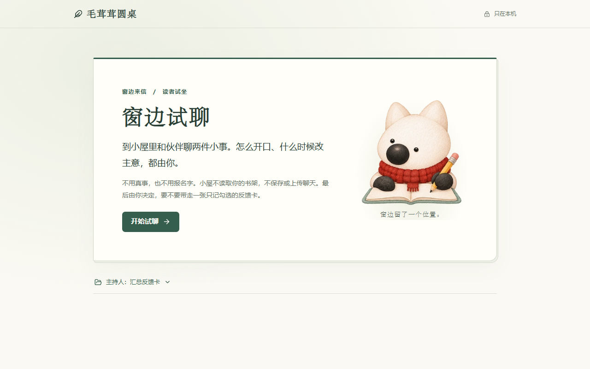

# 窗边试聊｜五位读者的小屋试用包

**状态：试用入口可用；本仓库尚未收到真人反馈。** 这次只想知道一件事：第一次来的人用自己的话改了口，伙伴的下一句有没有跟着变？不评打字速度、聊天轮数，也不测试跨月记忆。

[下载离线试用包（ZIP）](window-seat.zip?raw=true) · [查看文件](window-seat.zip) · [产品总设计稿](../superpowers/specs/2026-11-24-intent-first-cabin-design.md#6-先验对话再扩功能)

## 发给读者

1. **只发试用包，不发示例台词。** 解压后用桌面浏览器打开 `window-seat.html`；不用安装应用、登录或联网。聊天软件的文件预览可能不运行网页，请用浏览器打开。若已有运行中的新版应用，也可以直接打开它的 `/trial`。本机地址不是远程邀请链接。
2. 两桌都是真小屋：第一桌中途改变需要；第二桌从一件已经决定、但仍有现实难处的事开始。用自己的话，编一件小事也行。任选一桌，试试打字或换人时收屋，再回来。**不必说私事，不必聊完。**
3. 每桌之后只记三项：第一句是否是当时想听的；有没有追问或硬讲完；自己是否还得再解释。不想答可以留空，留空同样记作未确定。没开口就略过，全桌记作未确定。
4. 最后先核对六个勾选。愿意交回才点「下载匿名反馈卡」，把下载的 JSON 文件给主持人。**不要发聊天截图、屏幕录像或原话。** 也可以直接点「交给下一位读者」，不留一张卡。

## 主持人怎么收五份卡

- 找五位没见过测试台词的读者，各自完成两桌。不要在旁边代说、纠正或教系统听得懂的词。共用设备时，每人结束后点「交给下一位读者」；中途退出则点「丢弃本次试聊」。
- 每位读者只收一份。文件同名很正常，接收时可以依次另存为 `01.json` 到 `05.json`，不写姓名。卡内没有识别码，**工具不会也不能判断两份是否来自同一人**；请勿重复选同一人的副本。
- 在同一个离线页或 `/trial` 欢迎页底部点「主持人：汇总反馈卡」，可一次多选，也可从不同的文件夹逐份加入，合计最多五份。会按两桌分别显示每项的「是／没有／未确定」，不会混成一个分数。「清空汇总」或收起主持人面板会放下已选卡，可以重新开始；不会删除下载文件。含多余字段、格式不对或超过五份的新一批整批拒绝，先前选好的仍在，不显示错误文件里的内容。
- 先看**第一桌首句没接对**和**第二桌仍在追问或劝读者权衡**。有这种反馈就回到该场景，用新编的例子复核是没认出需求，还是安慰的措辞不合适；不能只凭勾选断定原因。「未确定」不计入肯定或否定，不把两桌当十位读者。未拿到真人反馈前，不扩大主动回访或长期记忆。

## 这桌会留下什么

| 动作 | 结果 |
| --- | --- |
| 收屋再回来 | 同一桌的聊天与未发草稿还在，期间不添新话。 |
| 去填反馈或略过 | 放下这桌的聊天与草稿；第二桌不会沿用第一桌的内容。 |
| 丢弃、换人、刷新或离开试用页 | 本次未导出的内容不保留。已下载的文件在下载目录里，由读者自己处理。 |
| 下载或汇总 | 卡内只有固定版本和两桌各三个枚举值，无姓名、时间、原话、草稿或设备标识。不会自动上交；汇总只在主持人的浏览器里完成。 |

这是**试用入口**的承诺，不是正式首页的存储说明。普通应用仍按原约定在本机保存阅读和聊天；试用不读取、写入或清空那些记录。网页版本会加载界面和美术文件，不提交聊天；离线版把同一套界面、接话逻辑和立绘装进一个文件，并禁止网络连接。两者均不调用知乎或在线模型。网页宿主和读者自行使用的输入法、截图工具不属于这份匿名反馈。

## 本版已验证（2026-11-24）

- 正式构建、类型检查、27 项行为检查、本机替身的接口检查通过。原有的改口、文章导读、阅读记录、书签浏览器回归均通过。
- 在 Edge 的桌面和 360 像素视口分别走通网页和解压后的离线文件。在两种入口的窄屏检查中，连续完成五次**合成读者**换人、导出和逐份／批量汇总，核对两桌共六行的分项计数。部分留空、全留空、同名文件、额外字段和第六份卡都单独检查过。
- 返回网页时实测命中浏览器的前进／后退缓存；离线文件则重新加载。两种情况都回到空白试用入口。未发现试用读取预置的个人记录、把原话写入存储或发出聊天请求。连续打出的两个 ZIP 字节一致。
- 对照固定设计标签，原始美术和 V6.1 动效目录未变；项目简介原有 10 个图片引用保留。以上是工程验证，**不是五位真人的结果**。

## 开发与复验

- `npm install` 后 `npm run dev`，在本机打开 <http://localhost:3100/trial>。同一入口也在普通书架的「窗边试聊」。
- `npm run pack:trial` 从同一个 `ReaderTrial`、`CabinModal` 和正式 `say` 重新打包；单文件在 `dist/reader-trial/window-seat.html`，分发件在 `docs/reader-trial/window-seat.zip`。修改相关代码或素材后须重新打包并验证压缩包，不要手改生成文件。
- `npm run test:companion`、`npm run typecheck`、`npm run build`、`npm run test:companion:api`。最后一项使用本机替身，不表示在线模型或知乎已被评测。
- 启动生产服务后运行 `python scripts/verify_trial.py --base http://127.0.0.1:3100 --channel msedge --zip docs/reader-trial/window-seat.zip`。同一组虚构读者动作分别跑桌面、360 像素窄屏、生产网页、解压出的离线页。它会检查两桌自由输入、收屋草稿、跳过、换人／返回／刷新、导出字段、本机五卡汇总、无效卡拒绝，以及预置的个人书架未被读取或改写。**合成卡只在临时测试环境中使用；不随包分发，不计入真人试用。**
- 正式小屋的原句书签、文章导读中断、迟到回执另由 `scripts/verify_bookmarks.py`、`scripts/verify_companion.py`、`scripts/verify_intent.py` 覆盖；本次两桌私聊不冒充已经验过真实读者的文章或长期记忆场景。
