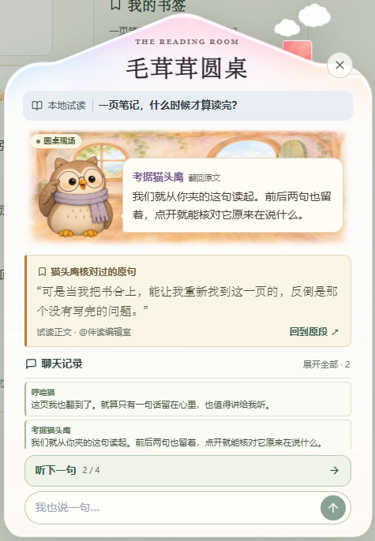
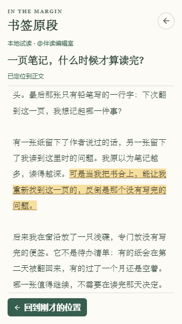

# 一句话书签 · 体验与验收

先在项目目录运行 `npm run dev`，打开 `http://localhost:3100/?sample=weekend-notebook`。这是编辑室试读，不是线上知乎数据。桌面原生划选或手机「逐句挑选」都可以开桌。下图只用本地原创试读截图，不分发真实回答和评论全文。

 

## 五位读者的小试用（待进行）

一人一张匿名观察表，只记是否找得到、在哪里停顿、便签是否合适；不抄读者选的私人内容或聊天原话。至少两位用手机；主持人不提前指按钮，也不替任何人作答。

| 任务（给读者） | 观察什么 |
| --- | --- |
| 找一句你愿意再想一下的话，带去和伙伴聊。 | 能否不经提示夹下原句？手机是否误选成一整段？ |
| 看完猫头鹰与柴犬的发言，找回原句前后的文字。 | 能否指出哪一句是作者说的、哪句来自读者？返回后是否还在同一轮讨论？ |
| 自己决定要不要收卡，再回到未聊完的一桌。 | 手账能否找到原段？不同书签是否容易认错？ |
| 在没有收卡的另一桌说一句话，然后继续阅读。 | 前台停留至少五分钟、有自然空档才可能出现便签。不强求触发；没出现就记「未观察」，不计为满意。 |

结束只问两句：**「刚才你怎么找回那句话的？」** **「猫出现时，你觉得它记得你、在催你，还是别的感觉？为什么？」** 建议先修复两个人独立遇到的同一障碍，再考虑增加动效或调整便签频率。这里没有填入任何试用结果。

## 可重复的工程验收

- `npm run test:companion`：原文位置与重句消歧、长文、敏感主题、收卡、打扰边界及旧存档。`npm run typecheck`、`npm run build` 之后执行 `npm run test:companion:api`；模型替身仅监听本机，测试校对原句与不同缓存，拒收对不上原文的输入。
- 网页运行时：`python scripts/verify_companion.py --channel msedge` 回归整篇流程；`python scripts/verify_bookmarks.py --channel msedge` 回归桌面选句、手机逐句挑选、高亮、回信与手账。加 `--shots docs/sentence-bookmarks` 可刷新本页两张**试读**截图。
- **真实内容，两种授权方式分开看**：若当前正式服务已配置知乎凭据，用 `python scripts/verify_bookmarks.py --base http://127.0.0.1:3100 --public "读书笔记 方法"` 直接测其接口。此方式会调用该服务的检索/分析配置。
- 若服务未配密钥、但本机已授权官方知乎 CLI，可在构建后执行 `python scripts/verify_public_bookmarks.py --cli "<已授权的官方 CLI 绝对路径>"`。独立生产预览只将**一次公开站内搜索**交给 CLI，原始响应走项目自己的归一化、正式接口、浏览器与手账；热榜、推荐检索、外部模型均不联网。不读取私人内容，不导出密钥。它验证真实原文及评论，**不证明线上部署或生产服务密钥可用**。检索没同时返回有/无精选评论的回答时明确失败。`--capture` 仅用于回放已取得的公开搜索，输出标为回放。

## 本次实测 · 2026-11-22

用本机已授权的官方 CLI 做公开搜索后，两篇来源都从正式阅读记录重新进屋，核对猫头鹰引文、柴犬所引评论，收卡后再从手账回看。两篇分别是[返回了精选评论的回答](https://www.zhihu.com/question/2378060303/answer/2031839365702350794)和[本次未返回精选评论的回答](https://www.zhihu.com/question/20700854/answer/2095103114655355541)。后者不等于原帖没有任何评论。测试没有调用外部模型，也没有把原帖全文或任何个人聊天存入仓库。
