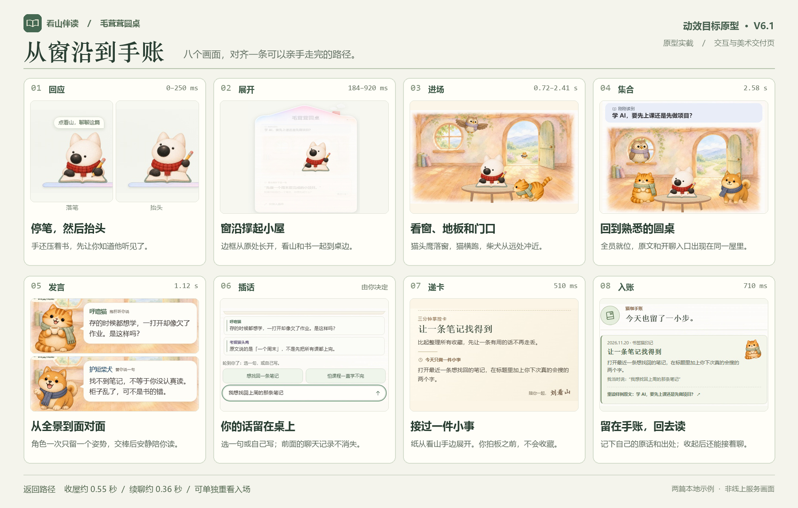

# 毛茸茸圆桌 · 交互目标 V6.1



找原始人设和窗沿动画，请看[原始美术与动效](../../assets/README.md)：含四角色三视图、完整开场 GIF，以及猫头鹰对话参考截图；这些与本版定稿立绘分别保留。

## 先体验

- **能点、能打字的版本：** 打开[单文件原型](../../public/previews/roundtable-v6.1/index.html)的 GitHub 文件页，点 **Download raw file** 下载，用浏览器打开。图已经装在文件里，不另下素材，也不需要密钥。
- **从正式项目打开：** 在仓库根目录运行 `npm run dev` 后，访问 `http://localhost:3100/previews/roundtable-v6.1/index.html`。在地址末尾加 `#portraits`，可直接从呼噜猫的第一句开始看。
- **只看效果：** [44.5 秒全流程实录](media/walkthrough.mp4) · [桌面小屋](media/cabin.png) · [手机插话态](media/mobile-chat.png)。

点右下角的看山，等三位伙伴进屋；让呼噜猫和猫头鹰说完，试着输入「我想找回上周的那条笔记」。柴犬接话，看山递卡；只有你点「我拍板，收进手账」才会保存。

## 三段动效，分别看什么

| 片段 | 对齐点 |
|---|---|
| [点开看山 → 小屋开聊](media/01-open.gif) | 看山的两只爪、笔和书保持连贯；猫头鹰飞近圆窗，猫从画外跑进来，柴犬从门后跑近。 |
| [呼噜猫 → 考据猫头鹰](media/03-speaker-handoff.gif) | 一人一张立绘：旧角色用 410 毫秒退出，新角色再用 710 毫秒出现。气泡留在原位。动作只做一次，留时间读字。 |
| [接过卡 → 入账 → 收屋](media/02-card-and-close.gif) | 看到卡片不等于已经收藏；拍板后，纸卡才飞向手账，小屋再折回窗沿。 |

## 定稿角色与分层素材

[四位伙伴的八张立绘总览](media/portraits.png)。下表链接是单张透明 PNG，可直接取用；原型运行时用的是对应的 WebP，不会把两种姿势叠在一起。

| 伙伴 | 倾听 | 发言 |
|---|---|---|
| 呼噜猫 | [抱杯听 · PNG](portraits/cat-listening.png) | [抱杯说 · PNG](portraits/cat-speaking.png) |
| 考据猫头鹰 | [倾听 · PNG](portraits/owl-listening.png) | [扶镜发言 · PNG](portraits/owl-speaking.png) |
| 护短柴犬 | [倾听 · PNG](portraits/dog-listening.png) | [抬爪发言 · PNG](portraits/dog-speaking.png) |
| 刘看山 | [伏案听 · PNG](portraits/fox-listening.png) | [停笔收口 · PNG](portraits/fox-speaking.png) |

[38 张 WebP 图层](source/assets/)按用途分成小屋 5 张、桌宠 13 张、伙伴入场 12 张、对话 8 张。[素材清单](source/assets-index.json)记录了每张的尺寸与用途。[实现对齐说明](motion.md)给出构图、动作时序、交互状态，以及正式接入时要保留的边界。

## 编辑与验证

[页面模板](source/template.html)和[样式](source/style.css)控制界面；[交互脚本](source/controller.js)控制对白、插话和收卡；[场景绘制](source/canvas.js)与[入场锚点](source/geometry.json)控制飞跑和落位。不要直接编辑内嵌图片的交付页。

修改源文件后，在仓库根目录运行（仅需 Python 3 标准库）：

```sh
python docs/visual-target-v6.1/source/build.py
python docs/visual-target-v6.1/source/build.py --check
```

第一条更新同一份可下载 HTML；第二条只读校验，核对源文件能否逐字节重建交付页。另有[可选的浏览器回归检查](verify_ui.py)：装有 Python Playwright 与 Chromium 的电脑运行 `python docs/visual-target-v6.1/verify_ui.py`；使用已安装的 Edge 时加 `--channel msedge`。这些工具只供开发验证，打开原型不需要它们。

**数据边界：** 两篇文章、对白和卡片都是离线示例。输入不发送，演示手账与正式数据分开保存；本次归档不替换正式应用的知乎接口、引文校验或正式手账。
